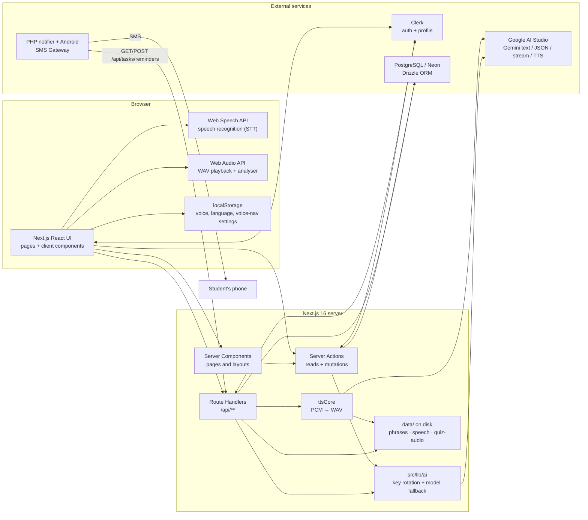
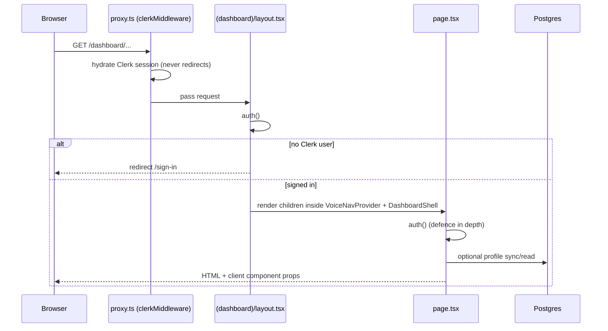
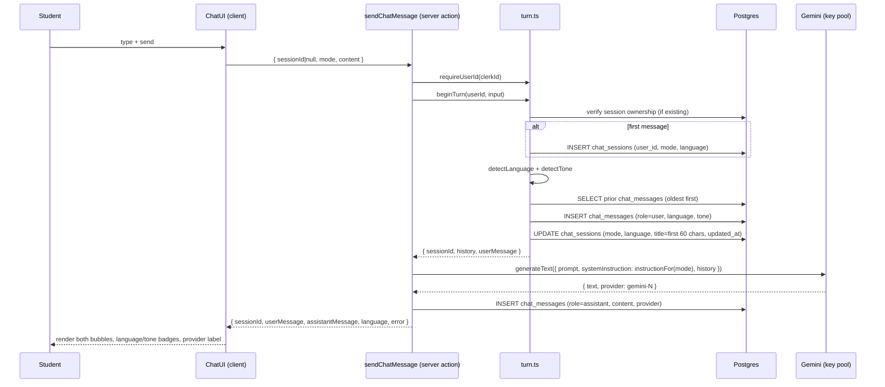
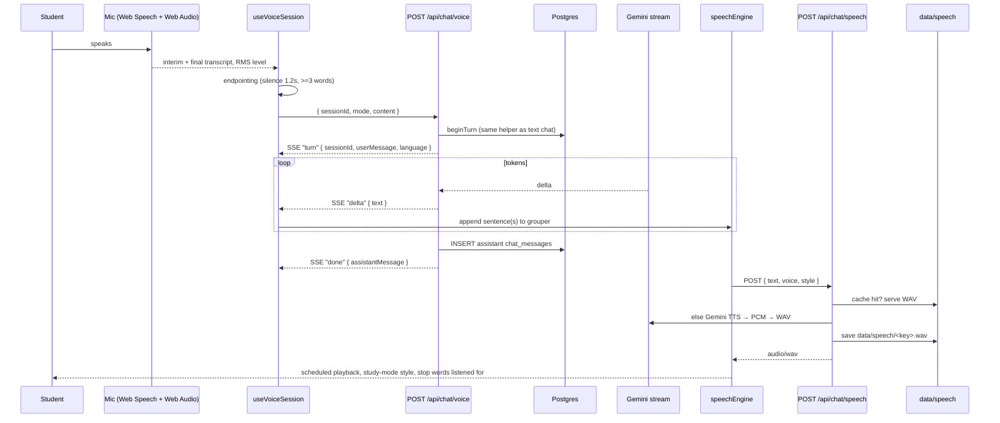
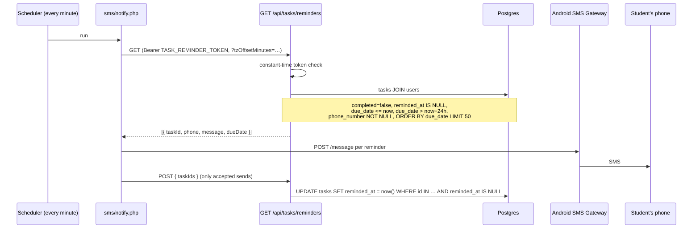
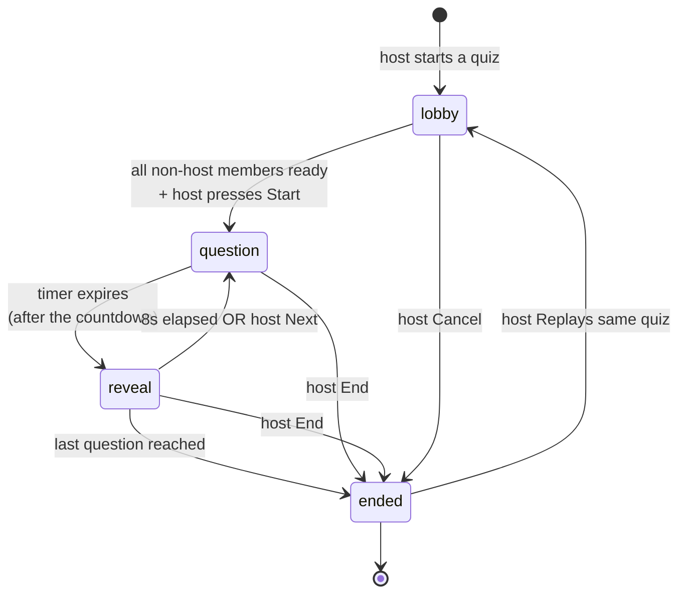
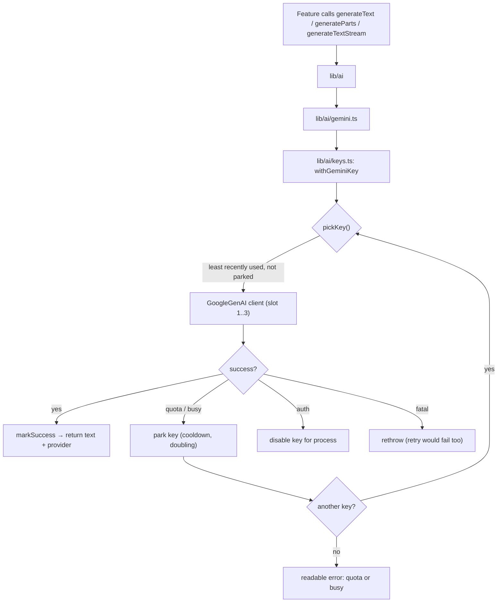
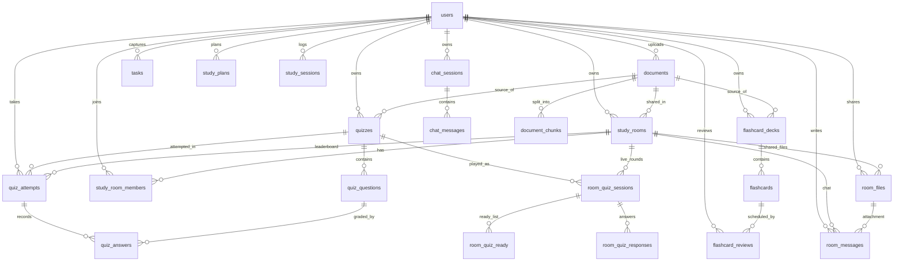

# EduVoice — Complete System Flow

> End-to-end reference for the app as implemented in this repository:
> **Next.js 16 App Router + Clerk + PostgreSQL/Drizzle + Google Gemini (text and
> TTS) + a PHP SMS gateway**.
>
> This document covers the whole path a request takes — what the student does,
> which component or server action handles it, which tables change, which
> external service is called, and how data moves between them. The database
> model is documented in full at the end, with an ER diagram.
>
> Companions:
> [`STUDENT_CAPABILITIES.md`](STUDENT_CAPABILITIES.md) (every screen action),
> [`SCHEMA.md`](SCHEMA.md) (schema rationale), [`ACTIVITY_DIAGRAM.md`](ACTIVITY_DIAGRAM.md)
> (swimlanes), [`EduVoice_Guide.md`](EduVoice_Guide.md) (feature catalogue),
> [`README.md`](README.md) (setup and the phrase bank).

---

## 0. Reading guide

| Term | Meaning here |
| --- | --- |
| **Student** | The signed-in end user. Every private row is keyed by `users.id`. |
| **App shell** | `src/app/(dashboard)/layout.tsx` + `DashboardShell`; wraps all `/dashboard/**` pages and mounts voice navigation. |
| **Server action** | A `"use server"` function, mostly in `src/features/*/server/actions.ts`. Called directly from client components; authenticates with Clerk inside. |
| **Route handler** | `src/app/api/**/route.ts`. Used where a server action cannot work: SSE streaming, binary upload/download, audio bytes, webhooks, cron. |
| **AI layer** | `src/lib/ai` — one Gemini entry point with a rotating key pool and model fallbacks. |
| **DB** | PostgreSQL (Neon in cloud, local Postgres in development) through Drizzle ORM (`src/lib/db`). |
| **Disk** | `data/` on the Next.js server: the committed phrase bank plus runtime WAV caches. |

### Five invariants the code enforces

1. **Server-only data access.** Clients never query Postgres. Pages/actions read;
   client components only hold what the server sent them.
2. **Authorization is re-checked per mutation.** Clerk identifies the caller,
   then every query scopes by `user_id` (or room membership). A guessed UUID
   never grants access.
3. **Grading is server-authoritative.** `SafeQuestion` strips `correctAnswer`
   and `explanation` from the question list; the attempt carries them separately
   as `answerKey` so spoken verdicts are instant, but `submitQuizAttempt`
   re-grades everything on the server before storing a score.
4. **Text-to-speech is always server-side Gemini TTS.** `window.speechSynthesis`
   is never used. If TTS fails the reply stays on screen and is simply not
   spoken (`SpeechSnapshot.unavailable`).
5. **Bytes bypass server actions.** Room files, quiz audio, speech WAVs and the
   voice SSE stream are route handlers; server actions handle JSON/FormData
   mutations with a 16 MB body cap.

---

## 1. System at a glance

### 1.1 Actors

| Actor | What they do |
| --- | --- |
| **Student** | Signs up/in, chats, uploads documents, takes quizzes, reviews flashcards, captures tasks, joins rooms. |
| **Room host (owner)** | A student who created a room: deletes the room, uploads files, writes/starts live quizzes, reveals/advances/ends rounds, removes members. |
| **Room member** | Joins with a code: chats, downloads files, readies up, answers live questions, appears on leaderboards. |
| **Clerk** | Identity provider. Emits `user.created/updated/deleted` webhooks. |
| **Gemini API** | Generates chat replies, document summaries/extraction, quiz JSON, flashcard JSON, and speech audio. |
| **SMS gateway cron** | Server-side PHP job (`sms/notify.php`) that polls due tasks and sends SMS through the student's phone. |
| **Scheduler** | Windows Task Scheduler / cron running the notifier every minute (or a few minutes). |

### 1.2 Context diagram



### 1.3 Layer responsibilities

| Layer | Owns |
| --- | --- |
| `src/app/(marketing)` | Public landing page, hero, feature sections, CTAs. |
| `src/app/(dashboard)` | Route protection, app shell, sidebar/topbar, voice-nav mount. |
| `src/app/(dashboard)/dashboard/**/page.tsx` | Auth guard, search-param parsing, rendering a feature UI. |
| `src/features/*/components` | Interaction: forms, recording, playback, quiz players, polls, overlays. |
| `src/features/*/server` | Authentication, ownership checks, DB writes, AI orchestration. |
| `src/features/*/lib` | Pure logic: language/tone detection, SM-2 scheduling, date parsing, live-quiz clock, retrieval scoring, trends. |
| `src/app/api/**` | Streaming, bytes, webhooks, token-authenticated cron endpoints. |
| `src/lib/ai` | Provider selection, key health, retries, JSON/streaming helpers. |
| `src/lib/db` | Pooled Postgres client and Drizzle schema. |

---

## 2. Request lifecycle, authentication and identity

### 2.1 Every page request



- `src/proxy.ts` only runs `clerkMiddleware()`; it deliberately never redirects,
  so Clerk sign-out server actions are not blocked. Protection is resource-based
  in the dashboard layout (and repeated in each page).
- `src/app/(dashboard)/layout.tsx` is `force-dynamic` and redirects to
  `/sign-in` when `auth()` has no user. It also mounts `VoiceNavProvider` and
  `VoiceNavOverlay`, so **every** dashboard page is voice-navigable.
- Pages are thin: they parse `searchParams` (e.g. `?room=`, `?retake=`,
  `?deck=`, `?topic=`) and render the feature's client UI, which fetches its
  initial data by calling server actions.

### 2.2 Clerk id → application user id

Every table stores `users.id` (uuid), but `auth()` returns a Clerk id
(`user_…`). Each server module resolves it with the same helper pattern
(`requireUserId` in chat/turn, quiz, flashcards, tasks, documents, rooms,
progress, and `resolveAppUserId` in room files):

```text
requireUserId(clerkId)
  ├─ getUserByClerkId(clerkId)  → found: return users.id
  └─ not found:
       currentUser() from Clerk
       upsertUser({ clerkId, email, name })
       return new users.id
```

Quiz additionally caches the mapping in a module-level `Map` for the process
lifetime. `upsertUser` inserts on `clerk_id` and updates email/name on conflict.

### 2.3 User sync paths

| Path | Trigger | Effect |
| --- | --- | --- |
| **Webhook** | Clerk sends `user.created` / `user.updated` to `POST /api/webhooks/clerk` | Verifies Svix signature with `CLERK_WEBHOOK_SECRET`, then upsert into `users`. |
| **Delete webhook** | `user.deleted` | Deletes the `users` row; all owned data cascades. |
| **Lazy fallback** | First dashboard visit or first server action when the webhook has not run | `upsertUser` creates the row on demand. |
| **Overview page** | `/dashboard` load | Tries `getUserByClerkId`, creates if missing, and shows a **Database unavailable** banner instead of crashing if Postgres is unreachable. |

### 2.4 Authorization matrix

| Resource | Read rule | Write rule |
| --- | --- | --- |
| Chat session/messages | `chat_sessions.user_id = me` | Same; session ownership re-checked in `beginTurn`. |
| Document/chunks | `documents.user_id = me` | Same. |
| Quiz/questions/attempts | `quizzes.user_id = me`; attempts additionally `quiz_attempts.user_id = me` | Same. |
| Flashcards | deck `user_id = me`; reviews `user_id = me` | Same. |
| Tasks | `tasks.user_id = me` | Same. |
| Study room | `study_room_members` row for `(room_id, me)` | Membership for chat; **owner** for files, quiz start, member removal, delete. |
| Room file bytes | Membership check before reading; scoped by `(file_id, room_id)` | Owner only (upload/delete). |
| Room quiz audio | Membership check | Owner only (upload/delete). |
| Personal quiz audio | Quiz ownership (`quizzes.user_id = me`) | Read-only route. |
| Speech WAV | Signed in only; keys are validated against a safe pattern | `POST` synthesizes/caches. |
| Reminder cron | `Authorization: Bearer TASK_REMINDER_TOKEN` (constant-time) | Same token. |

---

## 3. End-to-end user flows

Each section follows the same shape: **student actions → UI → server entry
point → data/AI/files → result shown**.

---

### 3.1 Landing page and authentication

**Page:** `/` (`src/app/(marketing)/page.tsx`)

**Student actions**

1. Scroll the landing sections (Home, Features, How it works, Languages) or use
   the navbar anchors; the active link highlights.
2. Watch the background hero video, read the rotating headline.
3. Click **Get started free** / **Get started** → `/sign-up`.
4. Click **See how it works** → scrolls to the how-it-works section.
5. Click **Sign in** → `/sign-in`.
6. If already signed in, click **Dashboard** → `/dashboard`, or open the Clerk
   avatar menu to manage the account / sign out.
7. Mobile: open the hamburger menu and use the same links.

**Flow**

```text
Landing (public)
  ├─ Get started  → /sign-up (Clerk form; verify email) → /dashboard
  ├─ Sign in      → /sign-in  (Clerk form)              → /dashboard
  └─ Dashboard    → /dashboard (requires Clerk session)
```

No database row is created until the Clerk webhook fires or the user opens a
dashboard page (lazy upsert).

---

### 3.2 Dashboard overview

**Page:** `/dashboard` (`src/app/(dashboard)/dashboard/page.tsx`)

**Student actions**

- Read the date and “Welcome back, {first name}”.
- Use quick actions: **Start a chat** → `/dashboard/chat`, **Generate a quiz** →
  `/dashboard/quiz`, **Add a task** → `/dashboard/tasks`.
- Read the four stat cards and the Getting started checklist.
- Read the Account panel: email, name, **DB sync** status.
- Read Recent activity.
- Open the avatar menu to manage the account / sign out.

**Server flow**

```text
OverviewPage (server component)
  ├─ auth() → no user → redirect /sign-in
  ├─ currentUser() → email, name
  ├─ getUserByClerkId(clerkId)
  │    └─ missing → upsertUser(...)
  ├─ catch DB error → dbError → amber banner ("Database unavailable")
  └─ render static quick actions / stats / checklist / activity
```

> **Implementation note:** the stats cards and Recent activity are currently
> static placeholders (`0`, `—`, “Nothing here yet”). The per-feature pages
> compute real numbers (quiz history, progress, tasks counts); wiring the
> overview to those aggregates is not implemented yet.

---

### 3.3 AI chat (text)

**Pages:** `/dashboard/chat`, `/dashboard/chat/[sessionId]`
**UI:** `ChatUI.tsx`

#### Student actions

| Action | UI behaviour |
| --- | --- |
| Type + **Enter** (Shift+Enter newline) or **Send** | Posts the message; a new session is created on the first message and the URL moves to `/dashboard/chat/{id}`. |
| **Mic** | Web Speech recognition fills the composer (interim words italic); unavailable browsers disable it with a tooltip. |
| **“+” menu → Upload file** | Adds preview chips only — attachments are **not** sent to the tutor yet. |
| **“+” menu → mode** | Chat / Hint / Debate / Interview; stored on the session. |
| **Tutor voice** dropdown | Chooses the TTS voice; persisted in `localStorage`. |
| **Voice mode** pill | Opens the hands-free overlay (§3.4). |
| **Listen / Stop** | Speaks the reply through Gemini TTS, or reports voice unavailable. |
| **Retry** | Re-runs the last user message after an AI failure. |
| **New chat / select history / delete chat** | Session management in the chat sidebar. |

#### Text turn flow



**Persistence details**

- Session title is the first user message truncated to 60 chars with `…`.
- `chat_sessions.language` and `chat_messages.language` are set from
  `detectLanguage` (`en`, `fil`, `ceb`).
- `chat_messages.tone` records the detected mood (`frustrated`, `confused`,
  `positive`, `neutral`) for the badge; the shared persona instruction also
  tells the model to simplify when the student sounds that way.
- Assistant `provider` is the key slot that answered (`gemini-1..3`).

**Reads / lifecycle actions**

| Action | Behaviour |
| --- | --- |
| `getChatSessions` | Sessions for the user, newest `updated_at` first, plus a one-query preview of the latest message per session. |
| `getChatMessages` | Returns `null` unless the session belongs to the caller; messages oldest-first. |
| `retryAssistantMessage` | Verifies ownership, rebuilds history excluding the last user message, calls the model, inserts a new assistant row. |
| `updateChatSessionMode` | Scoped update of `mode` + `updated_at`. |
| `deleteChatSession` | Scoped delete; messages cascade. |

**Failure handling**

- AI errors are caught in `sendChatMessage`; the user message is already saved,
  the action returns `error`, and the UI shows a retry banner.
- Streamed voice turns keep a partial answer if the stream breaks.

---

### 3.4 Voice mode (hands-free conversation)

**UI:** `VoiceMode.tsx`, `useVoiceSession.ts`, `speechEngine.ts`, `VoiceOrb.tsx`
**Transport:** `POST /api/chat/voice` (SSE)
**Speech:** `POST /api/chat/speech` (WAV)

#### Student actions

1. Open **Voice mode** from the chat composer.
2. The call opens with the mode's fixed opener, played from the pre-generated
   phrase bank (`data/phrases/`, no synthesis).
3. Speak naturally; pause ~1.2 s and the turn is sent.
4. The tutor's reply streams onto the screen and is spoken as it completes.
5. Say an explicit stop word (**stop**, **wait**, **sandali lang**, **hunong**) to
   **barge in**; other speech does not cut the tutor off. Press **■**,
   **Space** to mute, **Esc** to end.
6. Watch the orb, status chip (Your turn / Tutor is thinking / Tutor is speaking
   / Muted), timer, turn count and response-time badge.
7. Switch voices with the voice chips; use the typed fallback if the mic is
   blocked; **Retry** a failed turn.

#### End-to-end sequence



**Voice-specific rules**

- `beginTurn(..., historyLimit: 12)` keeps the voice prompt small for a fast
  first sentence.
- The system instruction is `voiceInstructionFor(mode)` (spoken, concise).
- Reply text is grouped into as few TTS requests as possible (normally one) so
  the voice does not change tone mid-answer; a long reply may become two.
- `speechEngine` caches response keys in memory and on disk, schedules chunks on
  one audio timeline, keeps ~9 s lookahead, and exposes an `AnalyserNode` for the
  orb.
- **No browser TTS fallback.** A failed synthesis sets `unavailable`; the reply
  remains visible.
- **The microphone hears the speakers.** Dictation discards recognition results
  while the tutor is speaking (and for a short tail after) so a reply played
  aloud is never typed into the student's input. Voice mode and voice navigation
  opt out only to hear an explicit stop word, and they filter that echo.
- Barge-in is decided by what the student says, not by microphone level. The
  recognizer stays open while the tutor talks and only an explicit stop request
  (`src/features/chat/lib/interrupt.ts`: "stop", "wait", "sandali lang",
  "hunong sa", …) interrupts it, so a cough or the tutor's own audio cannot cut
  an answer off. The recognizer is restarted on each transition into and out of
  playing, dropping those words instead of treating them as the next turn.

**Phrase bank** (`src/features/chat/lib/phrases.ts`, `scripts/generate-phrases.ts`)

- Fixed lines (mode openers, voice-nav confirmations) are pre-rendered with
  `npm run phrases:generate`.
- `data/phrases/` is committed; `data/speech/` is a runtime cache pruned to the
  newest 400 clips.

---

### 3.5 Documents: upload, extraction, grounded Q&A

**Page:** `/dashboard/documents`
**UI:** `DocumentsUI.tsx`

#### Student actions

1. Choose a **PDF / TXT / MD / CSV** (≤ 12 MB) and press **Upload & read**.
2. See the document appear with status **Reading…**, then **Ready** (or
   **Could not read**), its section count and summary.
3. Press **Ask** on a ready document.
4. Choose the answer language (English / Filipino / Cebuano).
5. Type a question (≤ 500 chars) or use the **mic**; use example chips.
6. Press **Ask** → answer, **Listen/Stop**, **From sections** citations, a
   weak-match warning if nothing matched, and the provider label.
7. Jump to **Flashcards** for that document, or **delete** it.

#### Upload flow

```text
DocumentsUI
  └─ uploadDocument(formData)            [server action]
       ├─ auth + requireUserId
       ├─ validate: file present/non-empty/≤12MB/supported type
       ├─ INSERT documents (status = "processing")
       ├─ extractDocument({fileName, mimeType, data})
       │    ├─ PDF  → Gemini inline data → JSON { text, summary }
       │    └─ text → stored as-is; one Gemini call for the summary
       ├─ chunkText(text) → deterministic chunks (~1.2k chars, max 1.8k)
       ├─ INSERT document_chunks (unique document_id + chunk_index)
       └─ UPDATE documents (summary, status="ready")
       on error → UPDATE documents status="failed", rethrow
```

- The row is created **before** AI work so a failure is visible and retryable.
- Filenames are stored (`documents.file_name`), but the original bytes are not
  kept — only the extracted text and summary.

#### Ask flow

```text
askDocument({documentId, question})
  ├─ auth + ownership lookup (documents.user_id = me)
  ├─ status must be "ready"
  ├─ load all document_chunks ordered by chunk_index
  ├─ selectChunks(question, chunks, maxChars=6000)
  │    └─ lexical scoring: stopword-filtered terms, rarity weighting,
  │       chunks within a margin of the best hit
  ├─ build prompt: "answer only from these excerpts, same language, admit gaps"
  ├─ generateText(...)
  └─ return { answer, sources[{index, excerpt≤180}], provider,
              weakMatch: every selected score === 0 }
```

Deleting a document is a scoped delete; chunks cascade. Quizzes and decks that
referenced it keep existing with `document_id = NULL` (`ON DELETE SET NULL`).

---

### 3.6 Quizzes

**Page:** `/dashboard/quiz` (deep links below)
**UI:** `QuizUI.tsx`, `VoiceQuizSession.tsx`

| URL | Meaning |
| --- | --- |
| `/dashboard/quiz` | Standalone quiz |
| `/dashboard/quiz?topic=…` | Topic pre-filled (Progress page sends weak topics here) |
| `/dashboard/quiz?room=<id>` | Score counts for that room’s leaderboard |
| `/dashboard/quiz?room=<id>&retake=<quizId>` | Straight into a retake linked to the room |

#### 3.6.1 Lobby and generation

**Student actions**

1. Name a topic **or** attach a file (PDF/TXT/MD/CSV); optionally add a focus.
2. Choose **3 / 5 / 8 / 10 / 15** questions.
3. Press **Start quiz** → “Writing questions…”.
4. In a room context, see the “scores land on its shared leaderboard” banner.
5. Alternatively pick a recent quiz to **retake**.

**Generation flow**

```text
QuizUI
  ├─ no file → generateQuiz({topic, count, roomId?})
  └─ file    → generateQuizFromFile(formData)
        └─ both call createQuiz()
             ├─ auth + requireUserId
             ├─ validate topic length / count clamp 3..15 / file ≤12MB
             ├─ if roomId: membershipFor(roomId, userId) (reject non-members)
             ├─ if roomId: read the room's document_id for attribution
             ├─ generateQuizQuestions({topic,count})
             │   or generateQuizQuestionsFromFile({file,...})
             │     └─ Gemini JSON; malformed items dropped/normalized
             ├─ INSERT quizzes (user_id, title, topic, document_id)
             ├─ INSERT quiz_questions (question, type, options, correct_answer,
             │                          explanation, order)
             ├─ render narration clips (best effort, see §3.6.3)
             │     └─ UPDATE quiz_questions.audio_file = "<questionId>.wav"
             └─ openAttempt(quizId, userId, roomId?)
                   ├─ if roomId: membership check again
                   ├─ count questions
                   └─ INSERT quiz_attempts (quiz_id, user_id, room_id,
                                            total_questions, started_at)
```

Validation limits:

- `topic` 3–200 chars (unless a file supplies the subject).
- Questions clamped to `MIN_QUESTIONS = 3`, `MAX_QUESTIONS = 15`.
- File ≤ 12 MB, PDF or text-like only.
- Question types: `multiple_choice`, `true_false`, `short_answer`; the prompt
  asks for 4 MC options and validation requires at least 2 with the answer
  matching one verbatim; TF is True/False; SA answer is a short phrase.

#### 3.6.2 Taking a quiz — manual

**Student actions**

- Click an option (A/B/C/D) or type a short answer.
- Number keys 1–9 select options; ←/→/Enter navigate.
- Click a progress segment to jump; **Previous/Next**.
- On the last question: **Submit answers**, **Go to the first blank**, or
  **Leave quiz**.

**Grading flow**

```text
QuizUI
  └─ submitQuizAttempt({attemptId, answers})
       ├─ auth + attempt ownership
       ├─ refuse if completed_at already set
       ├─ load all quiz_questions ordered by `order`
       ├─ grade each with isAnswerCorrect(type, correctAnswer, userAnswer)
       │    (empty answer = wrong)
       ├─ INSERT quiz_answers ... ON CONFLICT (attempt_id, question_id)
       │    DO UPDATE (idempotent re-submit)
       ├─ UPDATE quiz_attempts (score, total_questions, completed_at=now)
       └─ return score, total, roomId, per-question results + explanations
```

Results UI shows the score ring, correct/to-review chips, a room-leaderboard
confirmation when `room_id` is set, and every question with the student answer,
correct answer (for wrong ones) and explanation.

#### 3.6.3 Taking a quiz — voice

**Student actions**

1. Choose **Voice quiz** from the mode chooser.
2. **Start the voice quiz** → the first question is read aloud immediately.
3. The **30 s countdown** (`DEFAULT_QUESTION_SECONDS`) starts only when a
   question's clip or live synthesis finishes — the same rule as the study
   room's quiz.
4. Answer on **the manual quiz's own card** (same header, segments, lettered
   option buttons, typed field) with the voice layer on top. The option buttons
   are **never disabled by the voice stage** — only a question that already has
   an answer ignores a tap — so tapping works during the reading, during the
   countdown, and after a stalled stage; a tap during the reading ends the clip
   and reveals at once. The microphone opens with the question (the room quiz's
   rule) and the clip's own words are filtered out, so the read-aloud is never
   graded as the answer. **Repeat question**, **Stop listening**, and **Skip**
   sit below the card while the question waits.
5. The answer is judged from the interim or final transcript after ~900 ms of
   quiet. The verdict replaces the answering card: **Correct / Not this one /
   No answer**, the right answer and explanation, the correct option highlighted,
   and the room quiz's pre-recorded **correct/wrong** line played from the phrase
   bank.
6. The reveal is held for `REVEAL_SECONDS = 8`, then the next question starts by
   itself. Running out of time reveals the answer as unanswered (no wrong-answer
   line); **Skip** does the same on purpose.
7. The last reveal plays `quiz-finished` and hands every answer to the page,
   which submits the attempt with `submitQuizAttempt`.

**Pre-rendered narration (generation time)**

- `renderQuizQuestionAudio` runs after the quiz rows are inserted:
  - skips entirely when no key is usable (`hasReadyKey()` false);
  - concurrency **2**, total budget **45 s**;
  - each question → `questionNarration(question, position, total)` → Gemini TTS
    (style `tutor`) → WAV;
  - saves `data/quiz-audio/<quizId>/<questionId>.wav` and stamps
    `quiz_questions.audio_file = "<questionId>.wav"`;
  - a failed/quota/truncated clip leaves `audio_file` null; the player then
    synthesizes that question live through the normal speech route;
  - the first quota failure stops the remaining render early.
- Reading a clip: `GET /api/quiz/<quizId>/audio/<key>` verifies **quiz
  ownership** before reading the file.
- `startQuizAttempt` reports `audioStatus` `ready` only when every question has
  a clip.

**Answering flow**

- The microphone opens **with the question** (like the room quiz). Words heard
  while the clip plays — and for 1.2 s after it stops, when Chrome finalizes the
  clip's tail — are dropped, so the read-aloud is never graded as the answer.
  Tapping an option or submitting a typed answer works during the reading and
  ends the clip at once. **Repeat question** replays the clip through the same
  filter.
- Answers are judged from **interim or final** recognition after ~900 ms of
  quiet — waiting only for a final result could leave a short answer as an
  interim forever. The interim transcript is snapshotted **before** the
  recognizer is aborted, so an interim-only answer is never judged as silence.
- The quiz keeps its own recognizer alive: if Chrome ends the session on
  silence, it reopens it while the countdown runs. A reopen loop pauses once a
  quiet window is armed so it cannot reset the answer being judged.
- Only a **refused** microphone (`not-allowed` / no input device) stops
  listening for good. A transient error such as a lost speech-service
  connection is retried while the question waits, and the card says what went
  wrong instead of showing “Listening” over a dead microphone.
- Recognition steps down `ceb-PH → fil-PH → en-PH → en-US` when the browser
  rejects a language; Cebuano is rarely served, and English is always served.
- The answer is taken as spoken, using the room quiz's `resolveSpokenAnswer`:
  “letter B”, “the second one”, or the option's words become that option; any
  other choice transcript is graded verbatim, exactly as the room quiz grades
  it. Tapping an option or submitting a typed short answer wins over the mic.
- Silence is never marked wrong: a countdown that runs out records the question
  as **unanswered**, reveals the right answer and explanation, and plays no
  wrong-answer line. **Skip** does the same on purpose.
- Option cards are buttons and the short-answer field is available while the
  countdown runs; they are disabled only once the question has a verdict, so a
  tap is always an escape hatch.
- The answer key travels with the attempt: `startQuizAttempt` and
  `generateQuiz` return `answerKey` alongside the questions, so the session
  checks each answer locally with the shared `isAnswerCorrect` comparison.
- Voice navigation is suspended while the session is mounted, because two
  SpeechRecognition sessions in one tab fight over the same microphone.
- The verdict is one of the pre-rendered `quiz-correct-*` / `quiz-wrong-*`
  phrase-bank WAVs, played by key (a disk read, not a TTS request); a different
  take is picked each question. The answer/explanation is shown on screen rather
  than synthesized, so the next question is never held by a slow reveal.
- Safety net only: a missing key is fetched with `getQuizAnswerKey(quizId)`,
  and if that fails the session falls back to `gradeQuizAnswer({questionId,
  userAnswer})`, which returns `{correct, correctAnswer, explanation}` and
  writes nothing.
- The attempt is graded again at the end by `submitQuizAttempt`, so the verdict
  heard and the final score cannot disagree.
- `startQuizAttempt` is used for retakes; it creates a **new** `quiz_attempts`
  row and returns the safe questions, the audio status and the `answerKey`.

#### 3.6.4 Room-linked quizzes

- `roomId` on `quiz_attempts` is what makes a score appear on the room board.
- Membership is verified both when generating (`createQuiz`) and when opening an
  attempt (`openAttempt`), so passing an arbitrary `roomId` cannot attribute a
  score to a room the student is not in.
- Room leaderboards aggregate completed attempts by accuracy, then points.

---

### 3.7 Smart flashcards (SM-2)

**Page:** `/dashboard/flashcards`
**UI:** `FlashcardsUI.tsx`

**Deep links:** `?deck=` opens review, `?document=`, `?quiz=`, `?topic=` pre-fill
the maker.

#### Student actions

1. **Review {n} due** across all decks, or per deck: **Review** (due only) /
   **All**.
2. Create a deck from **Topic**, **Document**, or **Quiz**; choose card count.
3. In review: **Show answer**, then **Again (1) / Hard (2) / Good (3) / Easy (4)**
   (buttons or number keys), **Listen/Stop**, **Exit**.
4. Finish → summary (cards reviewed, how many “again” return, soonest due date).
5. **Delete** a deck.

#### Deck creation flows

| Source | Server action | AI? | Tables written |
| --- | --- | --- | --- |
| Topic | `createDeckFromTopic` | Yes (`generateCardsFromTopic`) | `flashcard_decks`, `flashcards` |
| Document | `createDeckFromDocument` | Yes (`generateCardsFromText` over summary + chunks) | same, with `document_id` |
| Quiz | `createDeckFromQuiz` | **No** — questions + correct answers become cards | same, no document |

Ownership is checked before any AI request: the document must be `ready` and
owned by the caller; the quiz must be owned by the caller.

#### Review scheduling (SM-2)

`reviewCard({flashcardId, rating})`:

```text
requireUserId
  ├─ ownership: card → deck → user_id = me
  ├─ load latest flashcard_reviews row for (card, me)
  ├─ scheduleReview(latest ?? INITIAL, rating, now)
  │     initial: ease 2.5, interval 0 days, repetitions 0
  │     again → ease −0.2, interval 0, repetitions 0, due +10 min
  │     hard  → ease −0.15, interval ×1.2 (min 1), repetitions +1
  │     good  → 1 day, then 6, then interval × ease
  │     easy  → max(4, interval × ease × 1.3), repetitions +1
  │     ease clamped 1.3..2.8; interval clamped 1..365
  └─ INSERT flashcard_reviews (append-only log with the resulting schedule)
```

- A card’s **current** state is its newest `flashcard_reviews` row
  (`latestReviewStates`, bounded to 5,000 rows).
- A card with **no** review row is due immediately (`dueAt = null`).
- `getReviewQueue` filters `isDue`, sorts overdue first, then never-reviewed,
  then soonest due; `includeNotDue` gives a full pass.

---

### 3.8 Tasks and SMS reminders

**Page:** `/dashboard/tasks`
**UI:** `TasksUI.tsx`
**Reminder transport:** `sms/` (PHP) + `GET/POST /api/tasks/reminders`

#### Student actions

**Capture**

1. Press the **big mic** and speak; continuous listening, auto-files after ~1.8 s
   of silence, or press **Add now** / **Discard** / tap the mic again.
2. Choose the dictation language (English / Filipino / Cebuano), remembered.
3. Or **type** a task and press **Add**.
4. See “Captured “{title}” — due {when}”.

**Manage**

- Count chips: open / due today / overdue.
- Tick/untick done; edit title + due date; delete; **Clear finished**.
- Source badge: 🎤 Voice or ⌨ Typed.

**Reminders**

- Save/update a Philippine mobile number; **Turn off**; **Send test text**.

#### Capture flow

```text
TasksUI
  └─ createTask({ text, source, tzOffsetMinutes })
       ├─ auth + requireUserId
       ├─ validate non-empty, ≤300 chars
       ├─ parseTaskInput(text, { tzOffsetMinutes })
       │    ├─ deterministic, no AI call
       │    ├─ English/Filipino/Cebuano date + time phrases
       │    ├─ resolves against the student's clock
       │    └─ returns { title (date words stripped), dueDate|null, language }
       └─ INSERT tasks (title, due_date, source)
```

- A task with no date is “anytime” (`due_date = NULL`).
- `updateTask` re-arms the reminder by setting `reminded_at = NULL` whenever the
  due date changes, so a moved deadline is texted again.
- `deleteTask` is scoped; `clearCompletedTasks` deletes all completed rows for
  the caller and returns the count.

#### Reminder flow (no Clerk session)



Details:

- Message body is composed server-side (`taskReminderBody`) in the student's
  timezone, e.g. `EduVoice: “Review chapter 4” is due now (Oct 16, 5:00 PM).`
- Anything > 24 h overdue is skipped; max 50 per run.
- A send is acknowledged **after** the gateway accepts it; a failure leaves the
  task queued for the next run.
- The **Send test text** button is a different path: the app posts to
  `SMS_SEND_URL` (`sms/send.php`) with `TASK_REMINDER_TOKEN`; that PHP endpoint
  talks to the gateway. The action never throws — it maps every failure
  (`no_number`, `unreachable`, `timeout`, `bad_response`, `token_not_configured`,
  `gateway_failed`, …) to a sentence and hint for the UI.
- `/api/tasks/reminders` is disabled (401 to everything) when
  `TASK_REMINDER_TOKEN` is unset.

---

### 3.9 Study rooms (async collaboration)

**Pages:** `/dashboard/rooms`, `/dashboard/rooms/{roomId}/history`
**UI:** `RoomsUI.tsx`, `RoomHistory.tsx`, `LiveRoomQuiz.tsx`

#### Lobby actions

- **Create room** (name → you become `owner`, a 6-char join code is generated
  from an unambiguous alphabet).
- **Join with code** (case/space-insensitive; idempotent).
- Open a room card; deep link `/dashboard/rooms?room=<id>`.
- **Copy join code**, open **History & scores**, **Delete** (owner) or **Leave**
  (member).

#### Create / join flow

```text
createStudyRoom({name})
  ├─ auth + requireUserId
  ├─ validate name (1..80)
  ├─ uniqueJoinCode() → retry up to 5× against UNIQUE join_code
  ├─ INSERT study_rooms (name, join_code, owner_id)
  └─ INSERT study_room_members (room_id, user_id, role="owner")

joinStudyRoom(code)
  ├─ normalize (trim, uppercase, strip spaces)
  ├─ find room by join_code (error if none)
  └─ INSERT study_room_members (role="member") ON CONFLICT DO NOTHING
```

`leaveStudyRoom` refuses owners (“delete the room instead”); `deleteStudyRoom`
checks `owner_id = me` and cascades members/messages/files/live sessions and
sets `quiz_attempts.room_id = NULL` for historical attempts.

#### Room screen data flow

| Panel | Server action | Query shape |
| --- | --- | --- |
| Room list | `getMyRooms` | membership JOIN room; member count + last message time via subqueries; newest room first. |
| Room state | `getRoomState` | membership gate; room, members with names/emails, leaderboard. |
| Leaderboard | `getRoomState` | completed `quiz_attempts` for the room grouped by user: attempts, points, answered, best; accuracy = points/answered, sorted accuracy → points. |
| Idle members | `getRoomState` | members with no completed room attempt. |
| Chat | `getRoomMessages(roomId, since?)` | membership gate; up to 200 messages, polled with a `since` cursor (2 s while visible). |
| Send | `sendRoomMessage` | membership gate; ≤2000 chars; insert. |
| Files | `getRoomFiles` / route | membership gate; metadata only, oldest first. |
| Members | `getRoomState` | roster with roles. |
| Remove member | `removeRoomMember` | owner only; cannot remove self/owner; also clears that user's `room_quiz_ready` rows for the room's sessions. |
| History | `getRoomAttempts` | completed attempts in room, newest first (limit 100), joined to quiz and user. |

#### Shared files

```text
Owner uploads (multipart)
  POST /api/rooms/[roomId]/files
    ├─ auth + resolveAppUserId + membership
    ├─ role must be owner
    ├─ validate ≤8 MB and allowed type/extension
    │    (PDF, DOC/DOCX, PPT/PPTX, XLS/XLSX, TXT, MD, CSV)
    ├─ INSERT room_files (bytes in `data` bytea)
    └─ INSERT room_messages (content = file name, file_id = new file)

Any member downloads
  GET /api/rooms/[roomId]/files/[fileId]
    ├─ auth + membership
    ├─ read by (file_id, room_id) — a file id alone is not enough
    └─ stream bytes with Content-Disposition (RFC 5987 UTF-8 name)
```

Files have **no public URL**; bytes live in Postgres. The chat message stays if
the file is deleted (`room_messages.file_id → NULL`). Only the owner can remove
a shared file (`deleteSharedFile` + `deleteRoomFile`).

---

### 3.10 Live room quiz (synchronized, voice-answered)

**Server:** `src/features/rooms/server/live.ts`
**Clock/scoring:** `src/features/rooms/lib/live.ts` (pure)
**UI:** `LiveRoomQuiz.tsx` (polling every 1 s), `ManualQuizBuilder.tsx`

This is a polling design, **not** WebSockets: the session row is the shared
clock. Every client derives the same phase from `question_started_at` +
`question_seconds` + `revealed_at`; the first poll after a deadline performs a
conditional `UPDATE`, so only one caller advances the state.

#### State machine



- `lobby`: waiting room. Host sees **Start the quiz** disabled until every
  non-host member is ready and there are ≥ 2 members.
- `question`: everyone sees the same question and countdown. Answers accepted
  only while `status = question` and `currentIndex` matches. The question runs
  its **full countdown even when every non-host member has answered** — the
  reveal is the clock's call, not the last answer's (
  `submitRoomLiveAnswer` no longer stamps `revealed_at`), so nobody sees the
  answer before the timer they are watching has ended.
- **The clock waits for the read-aloud.** Every question opens with a narration
  lead — `question_started_at = now + lead` — set *ahead* of the speech, so
  `remainingMs` reports the full question time until the reading is over and the
  countdown only starts when the audio does. `leadForQuestion` reads the exact
  duration of the rendered WAV from its RIFF header (`wavDurationMs`) plus a
  1.5 s delivery margin for the 1 s poll and clip start; a live-synthesized
  question falls back to `narrationLeadMs` (word estimate, cap 60 s) plus 3 s.
  The header shows **Reading…** for that window. Host **Reveal** is refused
  until the countdown reaches zero (the button is disabled too); **Skip** stays
  as the host's explicit override.
- `reveal`: correct answer, explanation and per-player responses visible.
  Held for `REVEAL_SECONDS = 8` before auto-advancing. Nothing has to be
  pressed: the round runs question → reveal → next on the shared clock.
- `ended`: final board; `finalizeSession` writes results to `quiz_attempts` and
  `quiz_answers` so the room’s normal leaderboard includes the round.

#### Host start paths

| Action | Server action | Source | Validation |
| --- | --- | --- | --- |
| Auto-generate from topic | `startRoomLiveQuiz` | Gemini (`generateQuizQuestions`) | host only, ≥2 members, topic 3–200, count 3–15, seconds 10–120 |
| Auto-generate from shared file | `startRoomLiveQuiz({fileId})` | Room file bytes → Gemini inline | host only, file must still exist |
| Write by hand | `startManualRoomLiveQuiz` | `ManualQuestionDraft[]` | host only, ≥2 members, 3–15 complete questions, audio keys must exist |
| Repeat a previous quiz | `replayRoomLiveQuiz` | Stored `quiz_questions` | host only, ≥2 members, reuses the same quiz id |

Each path:

1. Closes any non-ended session for the room (`status = ended`).
2. Creates a new `quizzes` row (except replay, which reuses the old quiz).
3. Inserts `quiz_questions` (manual questions include `audio_file`).
4. Renders the narration for every question that has no clip
   (`server/voiceRender.ts` → `POST`-free Gemini TTS → `server/quizAudio.ts`),
   stamping `audio_file`; two requests in flight, 60 s budget, and a failure
   leaves that question to live synthesis rather than failing the round.
5. Inserts `room_quiz_sessions` with `status = "lobby"`, `question_count`,
   `current_index = 0`, `question_seconds`, `started_at`, `question_started_at`.
6. Returns `{ sessionId, quizId, title }`; the UI opens the overlay.

#### Waiting room

```text
markRoomReady({roomId, ready})
  ├─ membership + latest session (parallel)
  ├─ session.status must be "lobby"
  └─ ready ? INSERT room_quiz_ready ON CONFLICT DO NOTHING
            : DELETE that row

startRoomLiveSession(roomId)
  ├─ host only
  ├─ readiness: memberCount >= 2 and every non-owner ready
  ├─ render any question still without a clip (the room waits in the lobby)
  ├─ conditional UPDATE lobby → question (currentIndex=0, questionStartedAt=now)
  └─ DELETE room_quiz_ready for the session
```

#### Poll, answer, and transition

```text
getRoomLiveState(roomId)        every 1 s per participant
  ├─ membership + latest session
  ├─ syncSession(session)       catch up to wall clock
  ├─ lobby: no questions/answers loaded
  ├─ question/reveal:
  │    load questions + all responses for the session
  │    question.correctAnswer / explanation only when revealed
  │    myAnswer / myCorrect, per-player responses (reveal only)
  │    board ranked by correct → total time → answered
  └─ remainingMs from the shared clock; serverNowMs for skew correction

submitRoomLiveAnswer({roomId, questionIndex, answer, responseMs})
  ├─ membership
  ├─ status must be "question" and index must match currentIndex
  ├─ server grades with isAnswerCorrect (client verdict is never trusted)
  └─ UPSERT room_quiz_responses
       UNIQUE (session_id, question_index, user_id)
```

Host controls:

| Action | Effect |
| --- | --- |
| `revealRoomLiveQuestion` | `question → reveal`, stamps `revealed_at` — **only once the countdown has reached zero**; before that (including the reading lead) it is a no-op. |
| `nextRoomLiveQuestion` | From `question`: closes to `reveal`. From `reveal`: advance to next `question` or `ended`. |
| `endRoomLiveSession` | `→ ended`, stamps `ended_at`, finalizes results. |

`syncSession` loop (each step a conditional UPDATE):

1. `question` elapsed ≥ `question_seconds` → `reveal`.
2. `reveal` held ≥ 8 s → next `question` at `currentIndex + 1`, or `ended` after
   the last question.
3. On `ended`, `finalizeSession` inserts one `quiz_attempts` row **per player
   who answered** (score = correct count, `room_id`, `started_at`, `ended_at`)
   plus their `quiz_answers`; `ON CONFLICT DO NOTHING` protects against repeats.

#### Narration for live rounds

- Every question has a pre-rendered clip by the time the round starts: the
  generation paths render `liveQuestionNarration` (`lib/narration.ts`) under
  `data/quiz-audio/<roomId>/`, `startRoomLiveSession` renders anything still
  missing while the room waits, and the waiting room reports
  "Voice ready for all N questions".
- The client plays `audioUrl` (`/api/rooms/<roomId>/quiz-audio/<key>`, members
  only) and opens the microphone when it ends, so the round runs without a
  synthesis pause between questions.
- A question with no clip — a spent quota, a render that never finished — is
  still synthesized live from the same words, so the round never stalls.
- Hosts can attach an audio clip per manual question:
  - `POST /api/rooms/[roomId]/quiz-audio` (owner only, ≤8 MB, MP3/WAV/OGG/M4A/
    WebM) → saved to `data/quiz-audio/<roomId>/<key>`; the returned key is stored
    in the draft and later in `quiz_questions.audio_file`.
  - `GET /api/rooms/[roomId]/quiz-audio/[key]` (member only) streams it.
  - `DELETE …` (owner only) removes it.
- At start, manual questions with missing audio keys are rejected rather than
  silently swapping in TTS.

#### Answering surface

`LiveRoomQuiz.tsx` renders the question with the same card the quiz page's voice
player uses (`features/quiz/components/MicOrb.tsx`, `VoiceQuizSession.tsx`):

- a stage orb plus "Question x of y" progress segments in the top panel;
- the question text, then its options as lettered (A, B, C…) cards — a tap
  submits that option, so the mic is never the only way to answer;
- the microphone opens with the question and closes when it is answered or the
  question closes; interim results count, and a 900 ms quiet window
  (`AUTO_SUBMIT_MS`) sends the answer, so a short answer the browser never
  finalizes is still heard;
- once the answer is in, the card shows the locked-in words, and after `reveal`
  the verdict (correct / not this one, the answer, the explanation) with the
  correct option highlighted;
- at `reveal`, the student who answered also hears the verdict: one of the
  pre-rendered `quiz-correct-*` / `quiz-wrong-*` clips from the phrase bank,
  played by key through the shared speech engine (`speakLine`), so the room's
  feedback is a disk read rather than a TTS request. A different take is picked
  each question, the host and non-answerers are silent, and the line stops with
  the overlay.

Room-only chrome stays: the countdown, the shared answered count, the host's
**Reveal / Skip / Next / End**, the **Live results** board and the **This
question** responses.

#### Leaderboards and history

| Read | Source | Ranking |
| --- | --- | --- |
| Per-round board (`state.board`) | `room_quiz_responses` in this session | correct → total response time → answered |
| Live all-time board (`getRoomLiveLeaderboard`) | all responses in all rounds of the room | accuracy → correct → total time → answered |
| Async room board (`getRoomState`) | completed `quiz_attempts.room_id` | accuracy → points |
| Live round history (`getRoomLiveHistory`) | ended `room_quiz_sessions` + responses | newest first, per-player correct/answered |
| Attempt history (`getRoomAttempts`) | completed `quiz_attempts` | newest first |

The history page (`/dashboard/rooms/{roomId}/history`) shows both the async and
live boards, each finished round with per-player scores, and all attempts; the
host can **Repeat** a round or a quiz.

---

### 3.11 Progress and trends

**Page:** `/dashboard/progress`
**UI:** `ProgressUI.tsx`, `charts.tsx`

**Student actions**

- Read headline stats: quizzes taken, average score (+ change vs. last window),
  accuracy, practice time; active days and streak.
- Read **What to study next** and press its CTA (**Practise this topic** →
  `/dashboard/quiz?topic=…`, **Try a new topic**, or **Take a quiz**).
- Read score trend, daily activity, by-question-type bars, weak/strong topics.
- Review recent quizzes (room tag) and jump back into a quiz.

**Server flow**

```text
getProgressOverview({tzOffsetMinutes})
  ├─ auth + requireUserId
  ├─ query completed quiz_attempts (≤200) JOIN quizzes, newest first, then reverse
  ├─ query quiz_answers (≤2,000) JOIN attempts/quizzes/questions
  ├─ buildTopicStats(attempts, answers)
  └─ return:
       summary        quizzes, questions, average/best, accuracy,
                      practice time (clamped 120 min/attempt), active days, streak
       change         % delta between the last 3 and the previous 3 attempts
       trend          last 10 attempts as chart points
       topics/weak/strong  per-topic accuracy (<80% and ≥2 answers = needs review)
       daily          last 7 local calendar days (attempts, minutes)
       questionTypes  MC / TF / short-answer accuracy
       recent         last 5 attempts
       nextStep       get-started | weak-topic (deep link) | stretch
```

All arithmetic is pure (`src/features/progress/lib/trends.ts`); SQL does no
grouping or scoring. `tzOffsetMinutes` is the browser's own offset so “today”
and the streak use the student's calendar, not the server's.

---

### 3.12 Voice navigation

**Mounted on every dashboard page:** `VoiceNavProvider` + `VoiceNavOverlay`
**Command grammar:** `src/features/voice-nav/lib/commands.ts` (data + parser)

**Student actions**

- Toggle with the floating button, the topbar mic badge, **Alt + V**, or by
  saying “turn on/off voice navigation”.
- Navigate by page name or synonym (“chat”, “quiz”, “notes”, “tasks”, “rooms”,
  “progress”, plus Filipino/Cebuano forms).
- **help / what can I say** → spoken + on-screen command list.
- **stop**, **repeat / say that again**, **read the page**.
- **scroll up/down/top/bottom**, **go back**, **next/previous**, **select**.
- **rescan the page**, **click 3 / number three / open the quiz**.
- Switch listening language; read the live transcript and spoken feedback;
  tap items in the “On screen” list.

**Flow**

```text
SpeechRecognition (Web Speech STT)
  └─ normalizeCommand(text)
       ├─ global commands (help/stop/repeat/read page/scroll/nav/click)
       ├─ page-specific commands (commandsForPath)
       └─ dispatch:
            ├─ router.push → dashboard route
            ├─ DOM action: scroll, click by index/name, focus, next/prev
            ├─ VoiceNav settings (language, enabled) → localStorage
            └─ speechEngine.speak(confirmation)
                 └─ POST /api/chat/speech (or a phrase-bank key)
```

The overlay scans clickable elements (buttons, links, `[role=button]`,
`[data-voice]`) into a numbered list; “rescan” refreshes it after navigation or
DOM changes. Confirmations use the fixed phrase bank so they are free to replay.

---

## 4. Cross-cutting pipelines

### 4.1 AI request pipeline (text, JSON, streaming)



Key behaviours:

- Env keys: `GEMINI_API_KEY`, `GEMINI_API_KEY_2`, `GEMINI_API_KEY_3`; duplicates
  ignored. Requests round-robin so parallel work spreads across free tiers.
- Quota/busy keys are parked (20 s minimum, doubling up to 1 h); 503s get two
  short in-key retries with backoff.
- `kind` on the error distinguishes `quota`, `busy`, `auth`, `fatal`.
- Model fallbacks (`GEMINI_MODEL_FALLBACKS`) are tried by `gemini.ts` when the
  primary model’s daily allowance is spent.
- The answering slot is stored as `provider` on chat messages for diagnostics.

### 4.2 Speech pipeline and caching

| Stage | Detail |
| --- | --- |
| Text cleanup | Markdown stripped; code blocks dropped; links/tables/lists preserved as prose. |
| Grouping | A reply is spoken as one take where possible; long text is cut deterministically (`SPEECH_GROUP_CHARS`/`SPEECH_BUDGET`) so live and replay produce the same cuts. |
| Synthesis | `POST /api/chat/speech` → `synthesizeSpeechBytes` → Gemini TTS (`GEMINI_TTS_MODEL`, voice from `GEMINI_TTS_VOICE`, style direction per mode). |
| Wrapping | Raw PCM (24 kHz, 16-bit mono) → `pcmToWav` RIFF header. |
| Caching | Key = SHA-1(`voice|text`) (style intentionally excluded). Hit → disk; miss → synthesize, save `data/speech/<key>.wav`, prune to 400 newest. |
| Phrase bank | Fixed keys (`phrase-*`) pre-rendered into committed `data/phrases/`, checked before the runtime cache. |
| Playback | Web Audio timeline, lookahead ~9 s, memory cache of 10 clips, interrupt fades, `AnalyserNode` for the orb. |
| Failure | No browser TTS. 502/429 surfaces as `unavailable`; the client may stop trying after 2 failures or a quota report. |

### 4.3 File and disk layout

| Path | Contents | Committed? |
| --- | --- | --- |
| `data/phrases/<key>.wav` | Fixed voice-mode openers and voice-nav confirmations | **Yes** |
| `data/speech/<hash>.wav` | Runtime TTS cache, pruned to 400 | No |
| `data/quiz-audio/<quizId>/<questionId>.wav` | Pre-rendered personal quiz narration (kept per quiz) | No |
| `data/quiz-audio/<roomId>/<key>` | Host-uploaded live-quiz narration clips | No |
| Postgres `room_files.data` | Shared room file bytes (`bytea`), never on disk | — |

All file names/keys are pattern-checked before touching a path; IDs are UUIDs or
safe slug/hash keys.

### 4.4 Error handling and degradation

| Failure | User-visible behaviour |
| --- | --- |
| Postgres unreachable on Overview | Amber “Database unavailable” banner; dashboard still renders. |
| Gemini quota/busy | Chat error + Retry; voice keeps partial text; TTS reports “voice unavailable”; quiz still generated if JSON succeeded. |
| Quiz TTS fails | Quiz is returned anyway; missing clips are synthesized live. |
| Document extraction fails | Row remains with `status=failed`, visible and deletable. |
| Room upload wrong type/size | 400/413 with a specific message. |
| Live quiz has <2 members | Host is told to share the join code. |
| Late live answer | Rejected (`accepted:false`); no row written. |
| SMS gateway offline | Test text explains the failure; reminder stays queued for the next cron run. |
| Invalid/expired speech key | 404; no path traversal. |

---

## 5. Inventory: pages, actions, routes

### 5.1 Pages

| Path | File | Purpose |
| --- | --- | --- |
| `/` | `src/app/(marketing)/page.tsx` | Public landing page. |
| `/sign-in` | `src/app/sign-in/[[...sign-in]]/page.tsx` | Clerk sign-in. |
| `/sign-up` | `src/app/sign-up/[[...sign-up]]/page.tsx` | Clerk sign-up. |
| `/dashboard` | `dashboard/page.tsx` | Overview, profile sync status, quick actions. |
| `/dashboard/chat` | `chat/page.tsx` | New chat. |
| `/dashboard/chat/[sessionId]` | `chat/[sessionId]/page.tsx` | Existing thread. |
| `/dashboard/documents` | `documents/page.tsx` | Upload + document Q&A. |
| `/dashboard/quiz` | `quiz/page.tsx` | Quiz lobby / player (`?room`, `?retake`, `?topic`). |
| `/dashboard/flashcards` | `flashcards/page.tsx` | Decks + review (`?deck`, `?document`, `?quiz`, `?topic`). |
| `/dashboard/tasks` | `tasks/page.tsx` | Voice/typed capture, reminders. |
| `/dashboard/rooms` | `rooms/page.tsx` | Room list + room view (`?room`). |
| `/dashboard/rooms/[roomId]/history` | `rooms/[roomId]/history/page.tsx` | Leaderboards, rounds, attempts. |
| `/dashboard/progress` | `progress/page.tsx` | Charts and recommendations. |

### 5.2 Server actions

| Module | Actions |
| --- | --- |
| `features/chat/server/actions.ts` | `getChatSessions`, `getChatMessages`, `sendChatMessage`, `retryAssistantMessage`, `updateChatSessionMode`, `deleteChatSession` |
| `features/documents/server/actions.ts` | `uploadDocument`, `getDocuments`, `getDocumentChunks`, `deleteDocument`, `askDocument` |
| `features/quiz/server/actions.ts` | `generateQuiz`, `generateQuizFromFile`, `startQuizAttempt`, `getQuizAnswerKey`, `gradeQuizAnswer`, `submitQuizAttempt`, `getRecentQuizzes`, `getRecentAttempts` |
| `features/flashcards/server/actions.ts` | `getDecks`, `getDeck`, `getReviewQueue`, `createDeckFromTopic`, `createDeckFromDocument`, `createDeckFromQuiz`, `reviewCard`, `deleteDeck` |
| `features/tasks/server/actions.ts` | `getTasks`, `getReminderPhone`, `saveReminderPhone`, `sendTestSms`, `clearReminderPhone`, `createTask`, `setTaskCompleted`, `updateTask`, `deleteTask`, `clearCompletedTasks` |
| `features/rooms/server/actions.ts` | `getMyRooms`, `createStudyRoom`, `joinStudyRoom`, `leaveStudyRoom`, `deleteStudyRoom`, `getRoomState`, `getRoomMessages`, `sendRoomMessage`, `getRoomFiles`, `deleteSharedRoomFile`, `removeRoomMember`, `getRoomAttempts` |
| `features/rooms/server/live.ts` | `startRoomLiveQuiz`, `startManualRoomLiveQuiz`, `replayRoomLiveQuiz`, `markRoomReady`, `startRoomLiveSession`, `getRoomLiveState`, `submitRoomLiveAnswer`, `revealRoomLiveQuestion`, `nextRoomLiveQuestion`, `endRoomLiveSession`, `getRoomLiveLeaderboard`, `getRoomLiveHistory` |
| `features/progress/server/actions.ts` | `getProgressOverview` |
| `features/auth/server/users.ts` | `upsertUser`, `getUserByClerkId`, `deleteUserByClerkId` |

### 5.3 Route handlers

| Method + path | Auth | Purpose |
| --- | --- | --- |
| `POST /api/chat/voice` | Clerk | SSE stream of a voice turn (`turn`, `delta`, `done`, `error`). |
| `POST /api/chat/speech` | Clerk | Text → WAV; disk cache; `200` playable or `429/502`. |
| `GET /api/chat/speech/[key]` | Clerk | Play a cached/phrase WAV. |
| `GET /api/quiz/[quizId]/audio/[key]` | Clerk + quiz ownership | Personal quiz narration clip. |
| `POST /api/rooms/[roomId]/quiz-audio` | Clerk + owner | Upload a live-quiz narration clip. |
| `GET /api/rooms/[roomId]/quiz-audio/[key]` | Clerk + member | Stream a live-quiz clip. |
| `DELETE /api/rooms/[roomId]/quiz-audio/[key]` | Clerk + owner | Delete a live-quiz clip. |
| `GET /api/rooms/[roomId]/files` | Clerk + member | List shared file metadata. |
| `POST /api/rooms/[roomId]/files` | Clerk + owner | Upload a shared file + chat message. |
| `GET /api/rooms/[roomId]/files/[fileId]` | Clerk + member | Download a shared file. |
| `GET /api/tasks/reminders` | Bearer token | Due reminders with composed messages. |
| `POST /api/tasks/reminders` | Bearer token | Acknowledge sent task ids (`reminded_at`). |
| `POST /api/webhooks/clerk` | Svix signature | Sync `users` on create/update/delete. |

---

## 6. Database schema

PostgreSQL, defined in [`src/lib/db/schema.ts`](src/lib/db/schema.ts), migrated
by Drizzle (`drizzle/0000…0007`). All ids are `uuid DEFAULT gen_random_uuid()`;
all timestamps are `timestamptz DEFAULT now()` unless noted.

### 6.1 Enums

| Enum | Values | Used by |
| --- | --- | --- |
| `message_role` | `user`, `assistant` | `chat_messages.role` |
| `chat_mode` | `chat`, `hint`, `debate`, `interview` | `chat_sessions.mode` |
| `question_type` | `multiple_choice`, `true_false`, `short_answer` | `quiz_questions.type` |
| `document_status` | `uploaded`, `processing`, `ready`, `failed` | `documents.status` |
| `task_source` | `voice`, `text` | `tasks.source` |
| `room_role` | `owner`, `member` | `study_room_members.role` |
| `room_quiz_status` | `lobby`, `question`, `reveal`, `ended` | `room_quiz_sessions.status` |
| `study_activity` | `chat`, `quiz`, `document`, `flashcards`, `tasks`, `other` | `study_sessions.activity_type` |
| `review_rating` | `again`, `hard`, `good`, `easy` | `flashcard_reviews.rating` |

`lobby` was added by migration `0005` (`ALTER TYPE … ADD VALUE … BEFORE
'question'`); the schema default is `question`, but every live session is
created explicitly in `lobby`.

### 6.2 Tables

#### `users` — local profile for each Clerk account

| Column | Type | Constraints |
| --- | --- | --- |
| `id` | uuid | PK |
| `clerk_id` | text | NOT NULL, UNIQUE |
| `email` | text | NOT NULL, UNIQUE |
| `name` | text | nullable |
| `avatar_url` | text | nullable |
| `phone_number` | text | nullable; E.164 PH mobile for reminders |
| `created_at` | timestamptz | NOT NULL, default now |
| `updated_at` | timestamptz | NOT NULL, default now |

Deleting a user cascades to essentially everything they own.

#### `chat_sessions` — one conversation

| Column | Type | Constraints |
| --- | --- | --- |
| `id` | uuid | PK |
| `user_id` | uuid | NOT NULL → `users.id` CASCADE |
| `mode` | `chat_mode` | NOT NULL, default `chat` |
| `title` | text | nullable; first message (≤60 chars) |
| `language` | text | nullable; `en`/`fil`/`ceb` |
| `created_at`, `updated_at` | timestamptz | NOT NULL |

Index: `chat_sessions_user_idx (user_id, updated_at)`.

#### `chat_messages` — one turn

| Column | Type | Constraints |
| --- | --- | --- |
| `id` | uuid | PK |
| `session_id` | uuid | NOT NULL → `chat_sessions.id` CASCADE |
| `role` | `message_role` | NOT NULL |
| `content` | text | NOT NULL |
| `language` | text | nullable |
| `tone` | text | nullable (`frustrated`, `confused`, `positive`, `neutral`) |
| `provider` | text | nullable (`gemini-1..3`) |
| `created_at` | timestamptz | NOT NULL |

Index: `chat_messages_session_idx (session_id, created_at)`.

#### `documents` — uploaded study material

| Column | Type | Constraints |
| --- | --- | --- |
| `id` | uuid | PK |
| `user_id` | uuid | NOT NULL → `users.id` CASCADE |
| `file_name` | text | NOT NULL |
| `file_type` | text | NOT NULL |
| `file_url` | text | nullable (reserved; bytes are not stored) |
| `summary` | text | nullable |
| `status` | `document_status` | NOT NULL, default `uploaded` |
| `created_at`, `updated_at` | timestamptz | NOT NULL |

Index: `documents_user_idx (user_id)`.

#### `document_chunks` — chunked, retrievable text

| Column | Type | Constraints |
| --- | --- | --- |
| `id` | uuid | PK |
| `document_id` | uuid | NOT NULL → `documents.id` CASCADE |
| `chunk_index` | integer | NOT NULL |
| `content` | text | NOT NULL |
| `created_at` | timestamptz | NOT NULL |

Unique: `document_chunks_doc_idx (document_id, chunk_index)`.

#### `quizzes` — a generated or hand-written quiz

| Column | Type | Constraints |
| --- | --- | --- |
| `id` | uuid | PK |
| `user_id` | uuid | NOT NULL → `users.id` CASCADE |
| `document_id` | uuid | nullable → `documents.id` SET NULL |
| `title` | text | NOT NULL |
| `topic` | text | nullable (topic or source file name) |
| `created_at` | timestamptz | NOT NULL |

Index: `quizzes_user_idx (user_id)`.

#### `quiz_questions` — items in a quiz

| Column | Type | Constraints |
| --- | --- | --- |
| `id` | uuid | PK |
| `quiz_id` | uuid | NOT NULL → `quizzes.id` CASCADE |
| `question` | text | NOT NULL |
| `type` | `question_type` | NOT NULL, default `multiple_choice` |
| `options` | jsonb | `string[]`, nullable |
| `correct_answer` | text | NOT NULL |
| `explanation` | text | nullable |
| `audio_file` | text | nullable; pre-rendered narration key |
| `order` | integer | NOT NULL, default 0 |

Unique: `quiz_questions_quiz_order (quiz_id, order)`.

#### `quiz_attempts` — one run of a quiz

| Column | Type | Constraints |
| --- | --- | --- |
| `id` | uuid | PK |
| `quiz_id` | uuid | NOT NULL → `quizzes.id` CASCADE |
| `user_id` | uuid | NOT NULL → `users.id` CASCADE |
| `room_id` | uuid | nullable → `study_rooms.id` SET NULL |
| `score` | integer | NOT NULL, default 0 |
| `total_questions` | integer | NOT NULL, default 0 |
| `started_at` | timestamptz | NOT NULL, default now |
| `completed_at` | timestamptz | nullable (null = in progress) |

Index: `quiz_attempts_user_idx (user_id, completed_at)`.

#### `quiz_answers` — per-question result of an attempt

| Column | Type | Constraints |
| --- | --- | --- |
| `id` | uuid | PK |
| `attempt_id` | uuid | NOT NULL → `quiz_attempts.id` CASCADE |
| `question_id` | uuid | NOT NULL → `quiz_questions.id` CASCADE |
| `user_answer` | text | NOT NULL |
| `is_correct` | boolean | NOT NULL |

Unique: `quiz_answers_attempt_question (attempt_id, question_id)` — also the
conflict target for idempotent re-submits.

#### `tasks` — hands-free study to-dos

| Column | Type | Constraints |
| --- | --- | --- |
| `id` | uuid | PK |
| `user_id` | uuid | NOT NULL → `users.id` CASCADE |
| `title` | text | NOT NULL |
| `description` | text | nullable |
| `due_date` | timestamptz | nullable (anytime) |
| `completed` | boolean | NOT NULL, default false |
| `source` | `task_source` | NOT NULL, default `text` |
| `reminded_at` | timestamptz | nullable; set when the SMS was handed off |
| `created_at`, `updated_at` | timestamptz | NOT NULL |

Indexes:

- `tasks_user_completed_idx (user_id, completed)`
- `tasks_due_reminder_idx (completed, due_date, reminded_at)` — the notifier’s
  queue query.

#### `flashcard_decks` — a set of cards

| Column | Type | Constraints |
| --- | --- | --- |
| `id` | uuid | PK |
| `user_id` | uuid | NOT NULL → `users.id` CASCADE |
| `title` | text | NOT NULL |
| `document_id` | uuid | nullable → `documents.id` SET NULL |
| `created_at` | timestamptz | NOT NULL |

#### `flashcards` — one front/back card

| Column | Type | Constraints |
| --- | --- | --- |
| `id` | uuid | PK |
| `deck_id` | uuid | NOT NULL → `flashcard_decks.id` CASCADE |
| `front` | text | NOT NULL |
| `back` | text | NOT NULL |
| `created_at` | timestamptz | NOT NULL |

Index: `flashcards_deck_idx (deck_id)`.

#### `flashcard_reviews` — append-only SM-2 log

| Column | Type | Constraints |
| --- | --- | --- |
| `id` | uuid | PK |
| `flashcard_id` | uuid | NOT NULL → `flashcards.id` CASCADE |
| `user_id` | uuid | NOT NULL → `users.id` CASCADE |
| `ease_factor` | real | NOT NULL, default 2.5 |
| `interval_days` | integer | NOT NULL, default 0 |
| `repetitions` | integer | NOT NULL, default 0 |
| `due_at` | timestamptz | NOT NULL |
| `rating` | `review_rating` | NOT NULL |
| `reviewed_at` | timestamptz | NOT NULL, default now |

Index: `flashcard_reviews_due_idx (user_id, due_at)`. A card’s current state is
its newest row per `(flashcard_id, user_id)`.

#### `study_rooms` — collaborative room

| Column | Type | Constraints |
| --- | --- | --- |
| `id` | uuid | PK |
| `name` | text | NOT NULL |
| `join_code` | text | NOT NULL, UNIQUE |
| `owner_id` | uuid | NOT NULL → `users.id` CASCADE |
| `document_id` | uuid | nullable → `documents.id` SET NULL |
| `created_at` | timestamptz | NOT NULL |

#### `study_room_members` — membership + role

| Column | Type | Constraints |
| --- | --- | --- |
| `id` | uuid | PK |
| `room_id` | uuid | NOT NULL → `study_rooms.id` CASCADE |
| `user_id` | uuid | NOT NULL → `users.id` CASCADE |
| `role` | `room_role` | NOT NULL, default `member` |
| `joined_at` | timestamptz | NOT NULL, default now |

Unique: `study_room_members_room_user (room_id, user_id)`.

#### `room_files` — shared file bytes

| Column | Type | Constraints |
| --- | --- | --- |
| `id` | uuid | PK |
| `room_id` | uuid | NOT NULL → `study_rooms.id` CASCADE |
| `user_id` | uuid | NOT NULL → `users.id` CASCADE (uploader) |
| `file_name` | text | NOT NULL |
| `file_type` | text | NOT NULL |
| `file_size` | integer | NOT NULL |
| `data` | bytea | NOT NULL (the bytes) |
| `created_at` | timestamptz | NOT NULL |

Index: `room_files_room_idx (room_id, created_at)`.

#### `room_messages` — room chat

| Column | Type | Constraints |
| --- | --- | --- |
| `id` | uuid | PK |
| `room_id` | uuid | NOT NULL → `study_rooms.id` CASCADE |
| `user_id` | uuid | NOT NULL → `users.id` CASCADE |
| `content` | text | NOT NULL |
| `file_id` | uuid | nullable → `room_files.id` SET NULL |
| `created_at` | timestamptz | NOT NULL |

Index: `room_messages_room_idx (room_id, created_at)`.

#### `room_quiz_sessions` — the shared live clock

| Column | Type | Constraints |
| --- | --- | --- |
| `id` | uuid | PK |
| `room_id` | uuid | NOT NULL → `study_rooms.id` CASCADE |
| `quiz_id` | uuid | NOT NULL → `quizzes.id` CASCADE |
| `host_id` | uuid | NOT NULL → `users.id` CASCADE |
| `status` | `room_quiz_status` | NOT NULL, default `question` |
| `question_count` | integer | NOT NULL, default 0 |
| `current_index` | integer | NOT NULL, default 0 |
| `question_seconds` | integer | NOT NULL, default 30 |
| `started_at` | timestamptz | NOT NULL, default now |
| `question_started_at` | timestamptz | NOT NULL, default now |
| `revealed_at` | timestamptz | nullable |
| `ended_at` | timestamptz | nullable |
| `created_at` | timestamptz | NOT NULL |

Index: `room_quiz_sessions_room_idx (room_id, created_at)`.

#### `room_quiz_ready` — waiting-room ready list

| Column | Type | Constraints |
| --- | --- | --- |
| `id` | uuid | PK |
| `session_id` | uuid | NOT NULL → `room_quiz_sessions.id` CASCADE |
| `user_id` | uuid | NOT NULL → `users.id` CASCADE |
| `ready_at` | timestamptz | NOT NULL, default now |

Unique: `room_quiz_ready_session_user (session_id, user_id)`;
index `room_quiz_ready_session_idx (session_id)`. Rows are cleared when the
session leaves the lobby.

#### `room_quiz_responses` — one spoken answer

| Column | Type | Constraints |
| --- | --- | --- |
| `id` | uuid | PK |
| `session_id` | uuid | NOT NULL → `room_quiz_sessions.id` CASCADE |
| `question_index` | integer | NOT NULL |
| `user_id` | uuid | NOT NULL → `users.id` CASCADE |
| `answer` | text | NOT NULL |
| `is_correct` | boolean | NOT NULL, default false |
| `response_ms` | integer | nullable; time from question open to answer |
| `created_at` | timestamptz | NOT NULL |

Unique: `room_quiz_responses_session_q_user (session_id, question_index, user_id)`
(index `room_quiz_responses_session_idx (session_id, question_index)`).

#### `study_plans` — weekly generated plan

| Column | Type | Constraints |
| --- | --- | --- |
| `id` | uuid | PK |
| `user_id` | uuid | NOT NULL → `users.id` CASCADE |
| `week_start` | date | NOT NULL |
| `content` | jsonb | `{ days: { day, topics[], activities[] }[] }` |
| `created_at` | timestamptz | NOT NULL |

Unique: `study_plans_user_week (user_id, week_start)`.

#### `study_sessions` — activity log for progress

| Column | Type | Constraints |
| --- | --- | --- |
| `id` | uuid | PK |
| `user_id` | uuid | NOT NULL → `users.id` CASCADE |
| `activity_type` | `study_activity` | NOT NULL |
| `topic` | text | nullable |
| `started_at` | timestamptz | NOT NULL, default now |
| `ended_at` | timestamptz | nullable |
| `duration_minutes` | integer | nullable |

Index: `study_sessions_user_started_idx (user_id, started_at)`.

> `study_plans` and `study_sessions` are defined in the schema but are not yet
> written by the current UI; Progress derives its numbers from `quiz_attempts`
> and `quiz_answers`.

### 6.3 ER diagram



### 6.4 Delete / retention behaviour

| Deleted row | Effect |
| --- | --- |
| `users` | Cascades: sessions/messages, documents/chunks, quizzes/questions/attempts/answers, tasks, decks/cards/reviews, owned rooms and memberships, messages, files, plans, sessions. |
| `chat_sessions` | Messages cascade. |
| `documents` | Chunks cascade; quizzes/decks/rooms referencing it keep existing with `document_id = NULL`. |
| `quizzes` | Questions, attempts, answers, live sessions cascade. |
| `quiz_attempts` | Answers cascade. |
| `flashcard_decks` | Cards and their review log cascade. |
| `study_rooms` | Members, messages, files, live sessions/responses/ready cascade; historical `quiz_attempts.room_id` becomes NULL. |
| `room_files` | Chat message stays, `file_id` becomes NULL. |
| A live session | Never deleted by normal play; it transitions to `ended`. |

---

## 7. Configuration

| Variable | Required | Used for |
| --- | --- | --- |
| `DATABASE_URL` | Yes | Postgres (Neon pooled connection or local). |
| `NEXT_PUBLIC_CLERK_PUBLISHABLE_KEY`, `CLERK_SECRET_KEY` | Yes | Clerk auth. |
| `CLERK_WEBHOOK_SECRET` | For webhook | Svix verification. |
| `NEXT_PUBLIC_CLERK_SIGN_IN_URL`, `…SIGN_UP_URL`, `…AFTER_SIGN_IN_URL`, `…AFTER_SIGN_UP_URL` | Recommended | Clerk routing. |
| `GEMINI_API_KEY`, `GEMINI_API_KEY_2`, `GEMINI_API_KEY_3` | At least one | Text/JSON/stream generation and TTS (shared pool). |
| `GEMINI_MODEL`, `GEMINI_MODEL_FALLBACKS` | Optional | Model and fallback list. |
| `GEMINI_TTS_MODEL`, `GEMINI_TTS_VOICE` | Optional | Speech model/voice. |
| `TASK_REMINDER_TOKEN` | For reminders | Shared secret for `/api/tasks/reminders` and `sms/`. |
| `SMS_SEND_URL` | For test SMS | Where `sms/send.php` is served. |
| `sms/.env`: `SMS_GATEWAY_USERNAME`, `SMS_GATEWAY_PASSWORD`, `EDUVOICE_URL`, `NOTIFY_TZ_OFFSET_MINUTES` | For SMS | Gateway credentials, app URL, timezone override. |

Notes:

- `next.config.ts` raises the server-action body limit to **16 MB** for quiz
  uploads and allow-lists Unsplash for landing images.
- `outputFileTracingIncludes` ships `data/phrases/**` with the speech route in a
  serverless build.
- The app must run on a filesystem that allows writes for the WAV caches; a
  read-only filesystem only loses caching, not the reply.

---

## 8. Known limitations / implementation notes

These are deliberate current boundaries, not bugs to “discover”:

1. **Overview stats are placeholders.** The four cards and Recent activity are
   static; real aggregates live on Quiz, Tasks and Progress pages.
2. **Chat attachments are preview-only.** The “+” menu lets a student attach
   chips, but files are not sent to the tutor.
3. **Document retrieval is lexical, not vector search.** No pgvector; the
   `document_chunks` table has no embedding column.
4. **Rooms are poll-based.** Chat polls every 2 s (paused when hidden), live quiz
   every 1 s; there is no WebSocket/SSE fan-out.
5. **Live quiz needs ≥ 2 members** and every non-host ready before it starts.
6. **Audio caches are local disk.** `data/speech` and `data/quiz-audio` do not
   exist across serverless instances unless the filesystem is persistent.
7. **TTS quota is shared with text generation.** A spent free tier degrades
   speech first (clips fall back to live synthesis, then to silence with an
   “unavailable” notice).
8. **`study_plans` / `study_sessions` are schema-only.** The adaptive planner
   and session log are not yet surfaced in the UI.
9. **Reminders require the external PHP cron.** Without a scheduler, due tasks
   simply wait; the in-app test button is a separate path.
10. **Only completed quiz attempts count** toward progress and room leaderboards;
    abandoned attempts are ignored.
11. **No UI attaches a document to a room yet.** `study_rooms.document_id` exists
    and quizzes prefer it when present, but the current create-room flow never
    sets it, so room quizzes use a topic or an uploaded/shared file instead.
12. **`startQuizAttempt` is not ownership-scoped.** It loads the quiz by id
    without filtering on `quizzes.user_id` (the UI only offers the caller's own
    quizzes, and `submitQuizAttempt`/`getQuizAnswerKey`/`gradeQuizAnswer` do
    check ownership). A
    leaked quiz id could therefore open a retake of someone else's quiz; add the
    user filter before exposing quiz ids more widely.

---

## 9. Appendix: two sequence summaries

### A. Text chat

```text
Student → ChatUI → sendChatMessage → beginTurn → Postgres
                                  → Gemini (rotating key)
                                  → saveAssistantReply → Postgres
        ← sessionId + both messages + provider
```

### B. Live room quiz round

```text
Host start → startRoomLiveQuiz → Gemini OR file/manual
           → quizzes + quiz_questions + room_quiz_sessions(lobby)
Members   → markRoomReady → room_quiz_ready
Host      → startRoomLiveSession → session(question, index=0, startedAt)
All       → getRoomLiveState every 1s (syncSession applies clock transitions)
Members   → submitRoomLiveAnswer → room_quiz_responses (server-graded)
Timer/host→ reveal → reveal (8s) → next question … → ended
Ended     → finalizeSession → quiz_attempts + quiz_answers per player
          → room leaderboards + history page
```
