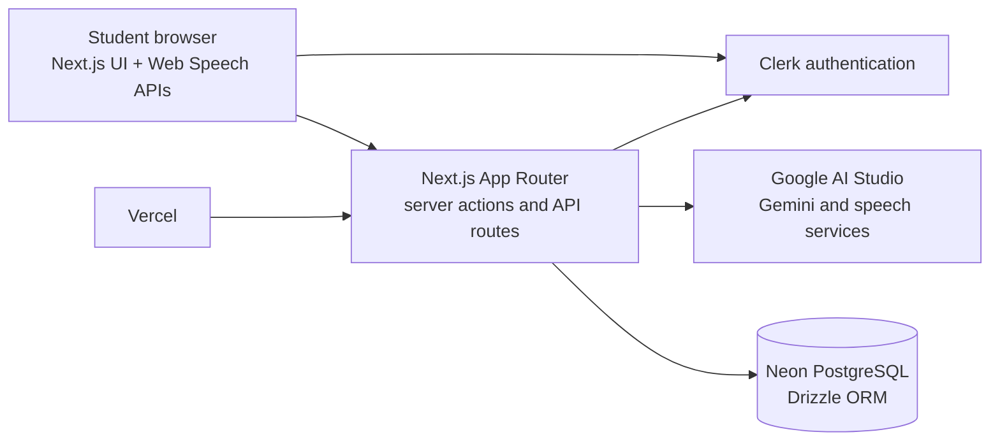

# EduVoice Feature Definition Document

## 1. Document Control

| Item | Value |
|---|---|
| Product | EduVoice |
| Document | Feature Definition Document (FDD) |
| Product type | Voice-enabled AI learning companion |
| Primary users | Students and independent learners |
| Initial study context | Learners in Polomolok, South Cotabato |
| Version | 1.0 |
| Date | 2026-10-12 |
| Source documents | `EduVoice_Guide.md`, `SCHEMA.md`, `ACTIVITY_DIAGRAM.md`, and the current `src/` implementation |

This document defines the functional scope and delivery expectations for EduVoice. Feature statuses describe the current repository state and are not a substitute for production readiness or user acceptance testing.

## 2. Product Overview

EduVoice is a centralized study platform that lets a student ask an AI tutor questions by text or voice, listen to spoken explanations, work with personal study materials, generate quizzes, capture study tasks, and review learning progress. The product is designed for hands-free learning and supports English, Filipino, and Cebuano interactions where the browser and configured AI services support them.

The product combines:

- AI tutoring and guided practice
- Voice input, speech output, and voice navigation
- Document-based study support
- Automatic quizzes and review materials
- Personal task tracking
- Collaborative study rooms
- Progress-driven recommendations

## 2.1 Functional Decomposition Flow

The following hierarchy decomposes EduVoice into independent functional areas. The lowest-level nodes are the features defined in Section 7.

```mermaid
flowchart TD
    EV[EduVoice Learning Assistant]

    EV --> AI[AI Tutoring and Voice Interaction]
    EV --> SM[Study Materials and Assessment]
    EV --> PM[Personal Study Management]
    EV --> CL[Collaborative Learning]
    EV --> AX[Access and Accessibility]

    AI --> AI1[Text-to-speech AI responses]
    AI --> AI2[Voice-based question and answer]
    AI --> AI3[Hint mode]
    AI --> AI4[Debate mode]
    AI --> AI5[Interview mode]
    AI --> AI6[Language detection]
    AI --> AI7[Tone and mood detection]

    SM --> SM1[Document upload and processing]
    SM --> SM2[Document-based question and answer]
    SM --> SM3[Document summaries]
    SM --> SM4[Quiz generation]
    SM --> SM5[Quiz taking and scoring]
    SM --> SM6[Smart flashcards]
    SM --> SM7[Spaced-repetition reviews]

    PM --> PM1[Hands-free task capture]
    PM --> PM2[Task list and reminders]
    PM --> PM3[Progress visualization]
    PM --> PM4[Performance trends]
    PM --> PM5[Adaptive study planner]

    CL --> CL1[Study-room creation]
    CL --> CL2[Room joining and membership]
    CL --> CL3[Room messaging]
    CL --> CL4[Shared quizzes]
    CL --> CL5[Room leaderboard]

    AX --> AX1[Clerk authentication]
    AX --> AX2[Voice navigation]
    AX --> AX3[Spoken command feedback]
    AX --> AX4[Typed and pointer fallbacks]
```

### Decomposition summary

| Major function | Independent sub-functions |
|---|---|
| AI Tutoring and Voice Interaction | TTS, voice Q&A, Hint, Debate, Interview, language detection, tone detection |
| Study Materials and Assessment | Upload and processing, document Q&A, summaries, quiz generation, quiz scoring, flashcards, spaced repetition |
| Personal Study Management | Voice task capture, task list, reminders, progress, trends, adaptive planning |
| Collaborative Learning | Room creation, membership, messaging, shared quizzes, leaderboard |
| Access and Accessibility | Authentication, voice navigation, spoken feedback, non-voice fallbacks |

## 3. Problem Statement

Students often have to switch between separate tools for tutoring, document review, quiz creation, reminders, and progress tracking. Typing every question slows study sessions and limits access for learners with visual strain, reading difficulties, or occupied hands. Students also need immediate practice and feedback without becoming dependent on direct AI answers.

EduVoice addresses these problems by keeping study activities in one authenticated workspace, allowing spoken interaction, grounding learning activities in the student's materials, guiding learners with hints, and recording outcomes for later review.

## 4. Goals and Success Measures

### 4.1 Product goals

1. Reduce the effort required to ask a study question.
2. Provide immediate, understandable tutoring support.
3. Help students practice instead of only consuming answers.
4. Turn personal notes into usable summaries, questions, quizzes, and flashcards.
5. Make core study flows usable without continuous typing.
6. Give students an evidence-based view of progress and weak topics.
7. Support individual and collaborative study in one platform.

### 4.2 Success measures

The following measures should be instrumented as the product matures:

- Percentage of chat turns completed with voice input.
- Time from document upload to a usable study artifact.
- Quiz completion rate and repeat-attempt rate.
- Percentage of tasks captured successfully from speech.
- Weekly active learners and returning study sessions.
- Improvement in accuracy on repeated topics.
- Voice-command success rate and unrecognized-command rate.
- User-reported usefulness of explanations and accessibility support.

## 5. Users and Actors

### Student

The primary actor. A student authenticates, asks questions, uploads material, takes quizzes, manages tasks, reviews progress, joins rooms, and controls the dashboard by voice.

### Classmate

A student who joins a shared study room, participates in room chat, takes room-linked quizzes, and appears on the room leaderboard.

### EduVoice system

The Next.js application validates requests, authenticates users, coordinates browser speech APIs, applies feature rules, stores records, and presents results.

### AI provider

Google AI Studio/Gemini generates tutor responses, mode-specific guidance, quiz content, summaries, and spoken output through configured provider services.

### Clerk

The authentication provider supplies the identity used to protect dashboard routes and synchronize local user records.

### Neon PostgreSQL

The persistent data store, accessed through Drizzle ORM, stores users, conversations, documents, quizzes, tasks, rooms, flashcards, study plans, and activity records.

## 6. Scope and Feature Catalog

Status meanings:

- **Implemented:** The repository contains an active user-facing flow and supporting logic.
- **Partial:** The data model or supporting logic exists, but the complete user-facing flow is incomplete.
- **Planned:** The feature is defined and represented in the product model, but the current user-facing implementation is not complete.

| ID | Feature | Status | Primary surface |
|---|---|---|---|
| F01 | Text-to-speech AI responses | Implemented | Chat and shared speech engine |
| F02 | Hint mode | Implemented | Chat mode |
| F03 | Document-based Q&A | Planned | Documents and chat |
| F04 | Quiz generation | Implemented | Quiz and chat-generated quiz flow |
| F05 | English, Filipino, and Cebuano detection | Implemented | Chat and voice navigation |
| F06 | Debate mode | Implemented | Chat mode |
| F07 | Interview mode | Implemented | Chat mode |
| F08 | Voice-based Q&A | Implemented | Chat and voice mode |
| F09 | Hands-free task capture | Implemented | Tasks |
| F10 | Progress visualization and trends | Planned | Progress |
| F11 | Tone and mood detection | Implemented | Chat message metadata and response orchestration |
| F12 | Smart flashcards with spaced repetition | Planned | Flashcards |
| F13 | Collaborative study rooms | Implemented | Study Rooms and room-linked quizzes |
| F14 | Accessibility voice navigation | Implemented | Dashboard-wide voice navigation |
| F15 | Adaptive study planner | Planned | Study plans |

## 7. Functional Requirements

### F01. Text-to-speech AI responses

**Purpose:** Let a learner listen to tutor responses instead of reading every response.

**Requirements:**

- Provide a listen action for an assistant response.
- Convert response text to speech through the shared speech engine and configured AI provider.
- Pause or coordinate recognition while EduVoice is speaking so the application does not hear its own output.
- Support the selected speech language and voice where available.
- Limit or handle overly long text safely.
- Report provider or browser failures without losing the text response.

**Acceptance criteria:** A student can select a tutor response, hear it spoken, stop or interrupt it, and continue the conversation when speech ends or fails.

### F02. Hint mode

**Purpose:** Encourage independent reasoning rather than immediate answer consumption.

**Requirements:**

- Allow the student to select Hint mode for a chat session.
- Send a mode-specific instruction to the AI provider.
- Prefer progressive clues, questions, and partial guidance over a complete answer.
- Preserve the conversation history and session mode.
- Allow the student to switch back to normal chat or another supported mode.

**Acceptance criteria:** A hint-mode response guides the learner toward a solution and does not intentionally reveal the final answer on the first response unless the learner asks to proceed.

### F03. Document-based Q&A

**Purpose:** Make uploaded study material searchable and useful for grounded questions.

**Requirements:**

- Accept supported PDF, Word, and text study files.
- Create a document record and expose processing status: uploaded, processing, ready, or failed.
- Extract and store document chunks.
- Generate and store a summary when processing succeeds.
- Answer questions using the selected document as the source of truth.
- Clearly report when the document does not contain enough information.
- Prevent one student from reading another student's documents.

**Acceptance criteria:** A ready document can be selected for Q&A, and an answer identifies or reflects the source material rather than inventing unsupported content. Failed processing shows a recoverable error.

### F04. Quiz generation

**Purpose:** Turn study material or a requested topic into immediate practice.

**Requirements:**

- Generate multiple-choice, true/false, and short-answer questions.
- Store quiz metadata and ordered questions.
- Associate a quiz with a source document when applicable.
- Allow the learner to start, answer, submit, and leave a quiz.
- Grade supported question types and show the result with explanations where available.
- Store attempts and per-question answers.
- Allow a quiz to be associated with a study-room leaderboard.

**Acceptance criteria:** A student can complete a generated quiz, submit answers once, receive a score, and find the attempt in the data used for later progress analysis.

### F05. English, Filipino, and Cebuano detection

**Purpose:** Let the learner interact in a familiar language.

**Requirements:**

- Detect or retain the input language for supported chat turns.
- Store language at the session and message level where known.
- Use the detected language when constructing the response and speech settings.
- Allow voice-navigation language selection where supported.
- Fall back clearly when confidence is low or a language is unsupported.

**Acceptance criteria:** A supported English, Filipino, or Cebuano input is recorded with its language and receives a response intended for that language.

### F06. Debate mode

**Purpose:** Practice argumentation and evidence-based reasoning.

**Requirements:**

- Let the student select Debate mode and state a topic or position.
- Have the tutor challenge the position with counterpoints and follow-up questions.
- Keep the tutor's role consistent throughout the session.
- Preserve the debate transcript for the session history.

**Acceptance criteria:** The tutor takes an opposing or challenging stance and asks the learner to support claims instead of only agreeing with them.

### F07. Interview mode

**Purpose:** Provide low-cost, on-demand job interview practice.

**Requirements:**

- Let the student identify a role or interview context.
- Ask one interview question at a time.
- Accept spoken or typed answers.
- Provide feedback on relevance, clarity, and confidence when the provider can evaluate them.
- Keep the session structured as an interview until the student exits or changes mode.

**Acceptance criteria:** A student can complete multiple interview turns and receive actionable feedback after an answer.

### F08. Voice-based Q&A

**Purpose:** Support hands-free conversation with the tutor.

**Requirements:**

- Use browser speech recognition for supported browsers.
- Show listening, interim transcription, thinking, speaking, and error states.
- Submit final speech text through the same tutor path used for typed messages.
- Allow the learner to interrupt or recover from recognition and microphone errors.
- Offer a typed fallback when recognition is unavailable.

**Acceptance criteria:** A student can ask a question by voice, see or hear that it was received, and receive a spoken or text answer without typing the question.

### F09. Hands-free task capture

**Purpose:** Record study tasks and due dates while the learner's hands are occupied.

**Requirements:**

- Accept voice or typed task entry.
- Transcribe voice input and parse common date/time phrases in English, Filipino, and Cebuano.
- Ask for or expose confirmation before saving ambiguous captured text where necessary.
- Store task source as voice or text.
- Allow tasks to be listed, completed, and managed by the owning student.
- Keep due dates optional.

**Acceptance criteria:** A spoken task such as “review biology tomorrow at 5 PM” creates an owned task with the correct title, source, and due date, or presents a clear correction path when parsing is ambiguous.

### F10. Progress visualization and trends

**Purpose:** Show what the learner knows and what needs review.

**Requirements:**

- Aggregate completed quiz attempts, per-question answers, topics, and study sessions.
- Calculate scores, accuracy, study time, and changes over time.
- Identify weak topics and suggest a next activity.
- Display empty, loading, and error states.
- Exclude incomplete attempts from completed-performance summaries.

**Acceptance criteria:** A learner with completed activity sees accurate summary values and a weak-topic suggestion; a new learner sees a useful empty state rather than misleading zeroed charts.

### F11. Tone and mood detection

**Purpose:** Adapt tutoring style when the learner appears confused, frustrated, stressed, positive, or neutral.

**Requirements:**

- Analyze supported user input and assign a tone label when confidence permits.
- Store tone with the user message.
- Use tone as a response-orchestration signal, not as a diagnosis.
- Prefer simpler explanations, reassurance, or clarification prompts for negative study signals.
- Avoid making clinical or sensitive mental-health claims.

**Acceptance criteria:** A tone-aware message stores its classification and produces an appropriate tutoring style without presenting the classification as a medical assessment.

### F12. Smart flashcards with spaced repetition

**Purpose:** Improve long-term retention through targeted review.

**Requirements:**

- Generate decks and cards from eligible documents, quizzes, or extracted concepts.
- Store front/back content and ownership.
- Present due cards first.
- Record review ratings: again, hard, good, or easy.
- Update interval, repetitions, ease factor, and next due date using the selected spaced-repetition algorithm.
- Keep review state per learner.

**Acceptance criteria:** A learner can review a card, submit a rating, and receive a deterministic next due date based on the stored review state.

### F13. Collaborative study rooms

**Purpose:** Support peer study, shared quizzes, and friendly competition.

**Requirements:**

- Allow an authenticated student to create a room with a unique join code.
- Allow another student to join or leave a room.
- Enforce owner and member permissions.
- Support room messages and member/state refresh.
- Link room quiz attempts to the room leaderboard.
- Handle deleted rooms, invalid codes, and membership changes safely.

**Acceptance criteria:** A room owner can create a room, a classmate can join with its code, both can exchange messages, and completed room-linked quiz attempts appear in the leaderboard data.

### F14. Accessibility voice navigation

**Purpose:** Make the dashboard operable without relying on continuous pointer or keyboard use.

**Requirements:**

- Wrap the authenticated dashboard in a shared voice-navigation provider.
- Support navigation commands for dashboard destinations in English, Filipino, and Cebuano synonyms.
- Support control commands such as help, stop, repeat, read page, scroll, back, next, previous, activate, and refresh targets.
- Register page-specific commands for interactive workflows such as quizzes.
- Expose current command, feedback, listening state, microphone state, and recognition errors.
- Provide a typed or pointer fallback for every critical operation.
- Respect microphone permission and allow the user to turn voice navigation off.

**Acceptance criteria:** A student can say a navigation command to open a dashboard section and can use help, target activation, scrolling, and stop commands without leaving the current dashboard session.

### F15. Adaptive study planner

**Purpose:** Convert performance data into a practical weekly study plan.

**Requirements:**

- Use quiz accuracy, weak topics, study history, and due review work as inputs.
- Generate a weekly plan with topics and activities by day.
- Store one plan per learner and week.
- Regenerate or update the plan when a learner requests it or meaningful performance changes occur.
- Explain why a topic was prioritized.

**Acceptance criteria:** A learner with sufficient history receives a weekly plan that prioritizes weaker topics and schedules review activities; a learner without history receives a setup state instead.

## 8. Core User Flows

### 8.1 Tutor conversation

1. The student opens Chat and selects Chat, Hint, Debate, or Interview mode.
2. The student types a message or speaks it through browser recognition.
3. EduVoice normalizes the input, detects language and tone, and stores the user message.
4. The system loads the conversation context and sends a mode-specific prompt to Gemini.
5. The assistant response is stored and displayed.
6. The student optionally selects Listen or continues by voice.

### 8.2 Study material to practice

1. The student uploads a supported study file.
2. EduVoice creates a document record and processes the file.
3. The system stores a summary and document chunks when processing succeeds.
4. The student asks grounded questions or requests a quiz.
5. EduVoice creates ordered questions and stores the quiz.
6. The student completes the quiz and the system stores the attempt and answers.

### 8.3 Voice task capture

1. The student opens Tasks and starts capture.
2. The student dictates a task, date, and optional time.
3. The browser transcribes the utterance.
4. EduVoice parses the task and due date and shows the draft.
5. The student confirms, edits, discards, or lets the configured pause behavior save it.
6. The task is stored with `source = voice` and appears in the task list.

### 8.4 Collaborative quiz

1. A student creates a study room and shares its join code.
2. Classmates join and see room membership and messages.
3. A member starts a quiz linked to the room.
4. The member submits the quiz.
5. EduVoice stores the attempt with the room ID and refreshes leaderboard data.

### 8.5 Voice navigation

1. The student enables Voice Navigation from the dashboard.
2. EduVoice listens for a final utterance and parses it against built-in and page-specific commands.
3. A recognized command opens a route, activates a visible target, scrolls, reads content, or runs a page action.
4. EduVoice announces the result using speech synthesis.
5. An unrecognized command leaves the current screen unchanged and offers help or recovery feedback.

## 9. System Architecture

### Technology boundaries

- **Frontend:** Next.js App Router, React, Tailwind CSS, Lucide icons, Motion/GSAP where used by the existing UI.
- **Authentication:** Clerk for sign-in, sign-up, route protection, and user identity.
- **AI:** Google AI Studio through `@google/genai`; provider key rotation and failure handling belong in the server-side AI layer.
- **Speech:** Browser speech recognition for input and the shared speech/TTS engine for spoken output.
- **Persistence:** PostgreSQL on Neon or local PostgreSQL, accessed through Drizzle ORM.
- **Deployment:** Vercel, with environment variables for authentication, database, and AI provider configuration.

## 10. Data and Ownership Rules

- Every user-owned record is scoped to the local `users.id` derived from the Clerk identity.
- Deleting a user cascades to their owned conversations, documents, quizzes, attempts, tasks, flashcards, rooms, plans, and study sessions according to the schema.
- Shared references such as a document attached to a quiz, deck, or room are set to null when the document is removed.
- A study-room member may read room state and messages only while membership is valid.
- A quiz attempt is visible to its owner and, when room-linked, to the room's supported leaderboard view.
- Voice audio is not required to be stored in the relational schema; the current model stores transcribed text and metadata.
- Semantic retrieval may later add vector storage to document chunks; until then, grounded document Q&A must not imply retrieval that is not implemented.

## 11. Non-Functional Requirements

### Security and privacy

- Protect all dashboard routes with Clerk authentication.
- Authorize every server action using the authenticated user, not a client-provided user ID.
- Keep AI provider keys and database credentials server-side.
- Validate file type, size, content, and processing status before use.
- Avoid exposing private document text, chat history, tasks, or room data across users.
- Treat tone labels as non-clinical product metadata.

### Reliability and recovery

- Show recoverable errors for unavailable AI, database, microphone, speech-recognition, and TTS services.
- Preserve typed text and completed user input when a downstream provider fails.
- Make repeated submissions idempotent where duplicate attempts could create incorrect scores or tasks.
- Use explicit loading, empty, success, and failure states for asynchronous features.

### Accessibility and usability

- Provide a non-voice fallback for every voice-controlled operation.
- Expose accessible names, focus states, and status announcements for interactive controls.
- Do not make speech recognition the only way to complete a critical flow.
- Keep text readable and avoid relying on color alone for status.

### Performance

- Avoid unnecessary database polling when a page is hidden.
- Paginate or bound long chat, room-message, document, and activity queries.
- Keep spoken responses within provider and browser limits.
- Process document work asynchronously when file size or provider latency requires it.

## 12. Delivery Roadmap

### Release 1: Core study loop

- Stabilize authentication and local user synchronization.
- Maintain Chat, voice Q&A, TTS, language support, Hint, Debate, and Interview modes.
- Maintain quiz generation, completion, scoring, and persistence.
- Complete error, loading, and accessibility states for the core loop.

### Release 2: Personal materials and organization

- Complete document upload, extraction, summary, chunking, and grounded Q&A.
- Complete flashcard generation and spaced-repetition review.
- Maintain voice and typed task capture with robust date parsing.

### Release 3: Insight and planning

- Implement progress queries and visualizations from completed attempts and study sessions.
- Add weak-topic analysis and next-activity recommendations.
- Implement adaptive weekly study plans and regeneration rules.

### Release 4: Collaborative and production hardening

- Harden room authorization, polling behavior, moderation, and leaderboard consistency.
- Add telemetry for feature success measures.
- Perform browser compatibility, accessibility, security, and load testing.

## 13. Open Decisions

- Which file-storage provider will hold uploaded documents and any future audio assets?
- Which document parsers and maximum file sizes are supported in production?
- Which Gemini model and response-safety settings are the production defaults?
- Should language detection be provider-based, local, or user-selectable when confidence is low?
- Which spaced-repetition algorithm and intervals will be treated as the product standard?
- What moderation and reporting rules apply to collaborative room messages?
- Which progress charts and planner rules are required for the first evaluated release?
- What browsers and mobile devices are within the supported speech-recognition matrix?

## 14. Traceability

| Product concern | FDD coverage |
|---|---|
| Faster, hands-free questions | F01, F08, F14 |
| Immediate AI tutoring | F02, F06, F07, F08 |
| Learning from personal material | F03, F04, F12 |
| Local-language accessibility | F05 |
| Critical-thinking practice | F02, F06, F07 |
| Task and reminder management | F09 |
| Learning measurement | F04, F10, F12, F15 |
| Peer learning | F13 |
| Unified authenticated workspace | System architecture, data ownership, and all F01-F15 requirements |

## 15. Definition of Done for a Feature

A feature is ready for release when:

- Its primary user flow works for an authenticated student.
- Unauthorized users cannot access its data or actions.
- Loading, empty, success, and failure states are handled.
- The feature has focused tests or an executable verification path.
- Persisted data follows the ownership and deletion rules.
- Voice features have an equivalent typed or pointer fallback.
- The feature's status and limitations are reflected in product documentation.
- The feature has been checked in supported desktop and mobile browser sizes where applicable.
